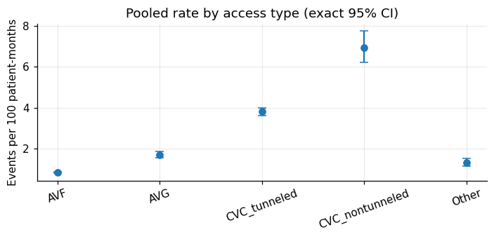
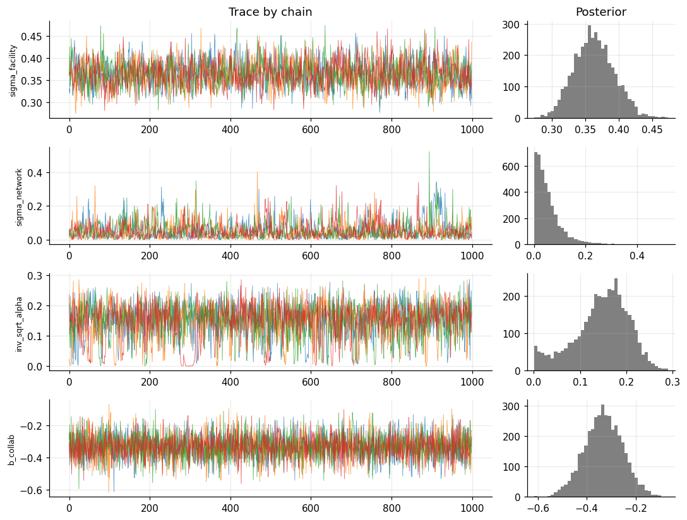
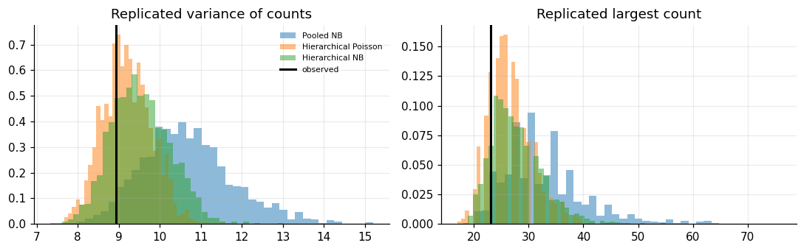
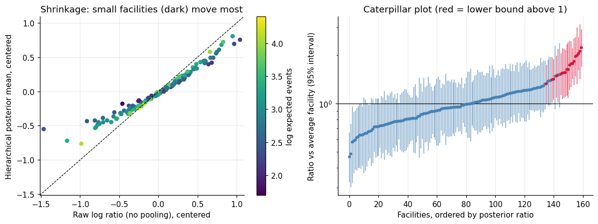

# 02. Rate Estimation and a Bayesian Hierarchical Model for Dialysis Events

[](https://colab.research.google.com/github/YOUR_GITHUB_USERNAME/nhsn-dialysis-analytics/blob/main/notebooks/02_rates_bayesian_glm.ipynb)


**Notebook:** [`notebooks/02_rates_bayesian_glm.ipynb`](../notebooks/02_rates_bayesian_glm.ipynb) | **Part 2 of 5** of the NHSN Dialysis Event surveillance analytics portfolio

> **Data statement.** All data are **synthetic**. No PHI and no real NHSN data are used. Event rates are illustrative, and the methods follow common surveillance practice but are **not** the official NHSN risk-adjustment methodology.

---

## TL;DR

Dialysis facilities report a handful of events per month, so a single event can swing a small facility's rate. This notebook estimates event rates properly and shows what a **Bayesian hierarchical model** adds over the classical standardized ratio.

| Question | Answer in this notebook |
|---|---|
| Is simple Poisson modeling good enough? | No. Counts are overdispersed (Cameron-Trivedi t = 7.7). The negative binomial model beats Poisson by **181 AIC points**. |
| Is zero-inflation the problem? | No. Zero-inflated Poisson (ZIP) beats Poisson but loses to the negative binomial. The zeros come from low rates and facility differences, not a separate "non-reporting" process. |
| Does partial pooling help? | Yes. Estimation error vs the known truth falls from **0.312** (raw ratios) to **0.257** (hierarchical), and from 0.408 to 0.330 for small facilities. |
| Does it remove all false flags? | **No**, and the notebook says so. With the same flagging rule, false flags among small facilities were tied (3 vs 3). The model is more accurate and more conservative, not error-free. |
| Does it find what was planted? | Yes. All nine parameters' 94% intervals contain the truth (true facility spread 0.35, estimated 0.364; true program rate ratio 0.70, estimated 0.72). |
| Are the networks different? | No (truth: they are not). The model estimates the network spread near zero (0.054) while raw network averages ranged 0.88 to 1.12. |

---

## How this notebook fits into the portfolio

| Notebook | Topic | Relation to this one |
|---|---|---|
| 01 | Synthetic data generator and data-quality validation | **Provides the data.** This notebook re-runs notebook 01's generator and validation rules (same seed, identical data) and analyzes only **validated** records. |
| **02** | **Rates, GLMs, Bayesian hierarchical model** | *You are here.* |
| 03 | Interrupted time series and difference-in-differences | Reuses the same world. Notebook 02 treated collaborative participation as a *nuisance covariate*; notebook 03 makes it the *question*. |

The generator's hidden "true" facility risk (`log_effect`) was never visible to any method in notebook 01. Here it is used **only for evaluation**, to check whether each method recovers the truth, a luxury that only synthetic data allow.

---

## Data

| Item | Value |
|---|---|
| Facilities / months | 160 facilities x 24 months (Jan 2023 to Dec 2024) |
| Validated records kept | 3,444 of 3,840 facility-months; 3,694 of 4,365 submitted events |
| Modeling table | 15,304 rows (facility-month x vascular access type); **81.6% are zero counts** |
| Bayesian model table | 1,579 rows (facility x access type x year), mean count 2.34, max 23 |
| Remaining contamination | 430 validated events (**11.6%**) are silent over-reports that no validation rule can detect (ground truth, evaluation only) |

Notebook 01 showed that plausible-looking over-reported events cannot be removed by rules. They remain here by design, so the models must tolerate a realistic residual data-quality problem. This matters for interpreting the results: rates sit about 10% above their design values, which matches the contamination share.

---

## 1. Standard metric: events per 100 patient-months

Pooled rates by vascular access type with exact (Garwood) Poisson 95% intervals:

| Access type | Events | Patient-months | Rate per 100 pm | 95% CI |
|---|---:|---:|---:|---|
| AVF | 1,151 | 141,063 | 0.82 | 0.77 to 0.86 |
| AVG | 485 | 28,752 | 1.69 | 1.54 to 1.84 |
| CVC, tunneled | 1,546 | 40,645 | 3.80 | 3.62 to 4.00 |
| CVC, nontunneled | 324 | 4,657 | 6.96 | 6.22 to 7.76 |
| Other | 188 | 14,374 | 1.31 | 1.13 to 1.51 |



*Vascular access type is the strongest risk factor, so every later model stratifies on it.*

---

## 2. Count-model GLMs with an exposure offset

Unit: facility-month x access type. Model:

```
log E[events] = access-specific intercept + year effect + program participation + log(patient-months)
```

The `log(patient-months)` **offset** turns coefficients into rates per patient-month.

| Model | Log-likelihood | AIC | Parameters | NB alpha | Delta AIC |
|---|---:|---:|---:|---:|---:|
| Poisson | -8,431.06 | 16,876.13 | 7 | n/a | 181.4 |
| **Negative binomial (NB2)** | -8,339.36 | **16,694.73** | 8 | 0.57 | **0.0** |
| Zero-inflated Poisson | -8,371.79 | 16,759.57 | 8 | n/a | 64.8 |

**Diagnostics.** Poisson Pearson chi-square / df = **1.22**; Cameron-Trivedi overdispersion alpha = 0.525 (t = 7.7, p = 1.2e-14). Facility-clustered standard errors are larger than model-based ones (second symptom of facility heterogeneity).

**Why ZIP is the wrong tool here.** ZIP improves on Poisson because an "excess zeros" component can partly mimic overdispersion, but it loses to the negative binomial. Its estimated structural-zero probability (0.265) should not be read literally: the zeros come from low rates plus facility heterogeneity.

Negative binomial coefficients (rates per 100 patient-months for access types; rate ratios otherwise):

| Term | Estimate | 95% CI |
|---|---:|---|
| AVF | 0.826 | 0.767 to 0.890 |
| AVG | 1.694 | 1.531 to 1.874 |
| CVC, tunneled | 4.051 | 3.784 to 4.338 |
| CVC, nontunneled | 7.468 | 6.598 to 8.454 |
| Other | 1.323 | 1.137 to 1.539 |
| Year 2024 vs 2023 (rate ratio) | 0.987 | 0.916 to 1.065 |
| Program participation, CVC rows, 2024 (rate ratio) | **0.744** | 0.639 to 0.866 |

The simulated program effect is 0.70; the classical estimate (0.744) covers it.

---

## 3. Standardized ratios (SIR) with exact Poisson intervals

`SIR = observed / expected`, with *expected* from the risk-adjustment model (negative binomial GLM with access mix, year, and participation, no facility term). A facility is flagged "high" if the exact 95% lower bound exceeds 1.

- **24 of 160** facilities are flagged by this classical rule.
- Small facilities get very wide intervals, and a single event can move a point estimate far from 1. This instability is what the hierarchical model is designed to reduce.

---

## 4. Bayesian hierarchical negative binomial model (PyMC)

### Model

```
events_i   ~ NegativeBinomial(mean = mu_i, dispersion alpha)
log(mu_i)  = log_rate_per_100pm[access_i] + b_year * year2024_i + b_collab * collab_cvc_post_i
             + log(patient-months_i / 100) + u[facility_i]

u[facility]     = network_effect[network(facility)] + sigma_facility * z_facility    (non-centered)
network_effect  = sigma_network * z_network
alpha           = 1 / inv_sqrt_alpha^2,   inv_sqrt_alpha ~ HalfNormal(1)
```

- **Partial pooling:** facility effects share a common spread (`sigma_facility`), so extreme estimates built on few events are pulled toward the group, while well-measured facilities barely move.
- **Nested structure:** facilities sit inside networks. If networks truly do not differ, `sigma_network` is estimated near zero, so the model refuses to invent network differences.
- **Weakly informative priors:** log-rates ~ Normal(0, 1.5); half-normal scales. A prior predictive check gives a median of 4,408 total events (5-95%: 1,042 to 29,635) against 3,694 observed: broad, but not absurd.
- **Non-centered parameterization** avoids the funnel geometry that causes divergences in hierarchical models.
- **Dispersion prior on 1/sqrt(alpha):** finite density at zero (the Poisson limit), which avoids the boundary problems a Gamma prior on alpha caused in early runs.

Three models are fitted so the added structure is **justified, not assumed**: *pooled NB* (no facility effects), *hierarchical Poisson*, and *hierarchical NB*.

### Sampling and convergence

4 chains x 1,000 draws after 1,000 tuning steps; `target_accept = 0.99` for the hierarchical models (a smaller step size removed the divergences left by 0.90 to 0.95, caused by a narrow funnel near `sigma_network = 0` with only six networks).

| Check | Result |
|---|---|
| Divergent transitions | **0** in all three models |
| Max R-hat | 1.006 (target < 1.01) |
| Min bulk ESS | 961 (target > 400) |



### Parameter recovery: does the model find what was planted?

| Parameter | Truth | Posterior mean | 94% interval | Truth inside? |
|---|---:|---:|---|:---:|
| Rate per 100 pm: AVF | 0.70 | 0.773 | 0.694 to 0.856 | yes |
| Rate per 100 pm: AVG | 1.50 | 1.577 | 1.382 to 1.771 | yes |
| Rate per 100 pm: CVC tunneled | 3.50 | 3.844 | 3.464 to 4.234 | yes |
| Rate per 100 pm: CVC nontunneled | 6.80 | 7.411 | 6.379 to 8.496 | yes |
| Rate per 100 pm: Other | 1.30 | 1.238 | 1.036 to 1.451 | yes |
| `b_year` | 0 | -0.001 | -0.074 to 0.067 | yes |
| `b_collab` | -0.357 | -0.332 | -0.482 to -0.186 | yes |
| `sigma_facility` | 0.35 | 0.364 | 0.310 to 0.421 | yes |
| `sigma_network` | 0 | 0.054 | 0.002 to 0.179 | boundary case (truth = 0) |

The access-type rates sit slightly above their design values. That is the silent over-reporting (11.6% of validated events): an honest, quantifiable bias from data quality, **not** a modeling failure.

---

## 5. Diagnostics: does the model fit, and which model predicts best?

### Posterior predictive checks

Simulate new datasets from each fitted model and compare summaries with the observed data (p-values near 0 or 1 signal misfit; 0.05 to 0.95 is acceptable):

| Statistic | Observed | Pooled NB (mean, ppp) | Hier. Poisson (mean, ppp) | **Hier. NB (mean, ppp)** |
|---|---:|---|---|---|
| Share of zeros | 0.315 | 0.325, 0.816 | 0.315, 0.515 | 0.318, 0.603 |
| Variance of counts | 8.926 | 10.673, **0.960** | 9.202, 0.669 | 9.533, 0.796 |
| Largest count | 23 | 32.770, **0.969** | 26.515, 0.857 | 27.683, 0.887 |
| 95th percentile | 9 | 8.593, 0.577 | 8.203, 0.202 | 8.282, 0.281 |



*The pooled model (blue) overestimates both variance and extremes: when facility differences are ignored, they get absorbed into overdispersion. The hierarchical models (orange, green) sit around the observed value (black line).*

### Predictive-interval calibration

Share of observed counts falling inside central predictive intervals (counts are discrete, so coverage runs a little high):

| Nominal | Pooled NB | Hier. Poisson | Hier. NB |
|---:|---:|---:|---:|
| 50% | 0.736 | 0.773 | 0.778 |
| 80% | 0.913 | 0.933 | 0.937 |
| 90% | 0.957 | 0.970 | 0.974 |

### Leave-one-out cross-validation (PSIS-LOO)

| Model | ELPD | SE | Effective params | ELPD difference vs best | Weight |
|---|---:|---:|---:|---|---:|
| Hierarchical Poisson | -2,470 | 40 | 128.2 | 0 | 0.91 |
| Hierarchical NB | -2,470 | 39 | 118.1 | 0.0 +/- 2.1 | 0.00 |
| Pooled NB | -2,580 | 40 | 8.2 | **-110 +/- 17** | 0.09 |

**Reading this.** The pooled model is clearly worse (about 110 ELPD, far beyond its standard error). The two hierarchical models are **statistically indistinguishable**. That is informative: once facility effects are included and counts are summed to facility x access x year, month-to-month extra-Poisson noise averages out, leaving little for the dispersion parameter to explain. The negative binomial is kept as the safer default for sparser or noisier data (such as month-level data in notebook 03). LOO flagged 3 observations in the hierarchical NB model with Pareto k > 0.7, so individual LOO estimates are slightly less reliable; the large gap to the pooled model is robust to this, but the near-tie should be read with caution.

---

## 6. What partial pooling buys: shrinkage, accuracy, and flagging

All comparisons use the **known true facility effects** as the yardstick, on a centered log scale. This is possible only because the data are synthetic.



*Left: raw facility ratios (x) versus hierarchical posterior means (y). Extreme raw values are pulled toward the center, most strongly for facilities with little data (dark points). Right: all 160 facilities with 95% intervals; red marks a lower bound above 1.*

### Accuracy against the truth (root mean squared error on the log-ratio scale)

| Facilities | n | No pooling (raw) | **Hierarchical** | Complete pooling | 94% interval covers truth |
|---|---:|---:|---:|---:|---:|
| All | 160 | 0.312 | **0.257** | 0.363 | 0.869 |
| Small | 54 | 0.408 | **0.330** | 0.380 | 0.815 |
| Medium | 53 | 0.290 | **0.234** | 0.324 | 0.849 |
| Large | 53 | 0.201 | **0.183** | 0.382 | 0.943 |

Intervals under-cover slightly for small and medium facilities, partly because the silent over-reports inflate some facilities in a non-normal way that the model does not represent.

### Who gets flagged, and was the flag right?

Same decision rule for both methods: *flag if the lower 95% bound of the facility ratio exceeds 1*.

| Facilities | Truly >= 1.5x | Classical: flagged / false / caught | Hierarchical: flagged / false / caught |
|---|---:|---|---|
| All | 20 | 24 / 3 / 13 | 20 / 3 / 12 |
| Small | 7 | 10 / 3 / 3 | 8 / 3 / 3 |
| Medium | 4 | 6 / 0 / 3 | 4 / 0 / 2 |
| Large | 9 | 8 / 0 / 7 | 8 / 0 / 7 |

*"False" means flagged although the true ratio was below 1.1. "Caught" means flagged and truly 1.5x or higher.*

**Honest reading:** the hierarchical model is more conservative (20 vs 24 flags) and more accurate, but with 160 facilities it does **not** eliminate false flags. Differences of one or two facilities are noise.

### Call lists for outreach (top 15 facilities)

| Call list | Truly >= 1.5x | Not elevated (true < 1.1x) | Small facilities on list | Mean true ratio |
|---|---:|---:|---:|---:|
| Classical, ranked by SIR | 8 | 3 | 10 | 1.675 |
| Hierarchical, ranked by posterior ratio | 9 | 3 | 7 | 1.679 |

### Networks: real differences or noise?

The simulator has **no true network effect**. Raw network averages differ anyway; the hierarchical model shrinks them toward zero.

| Network | Facilities | Raw pooled SIR | Hierarchical ratio (94% interval) |
|---|---:|---:|---|
| NW-01 | 33 | 0.984 | 0.999 (0.911 to 1.100) |
| NW-02 | 36 | 0.982 | 1.002 (0.914 to 1.104) |
| NW-03 | 31 | 1.093 | 1.011 (0.926 to 1.130) |
| NW-04 | 21 | 0.882 | 0.979 (0.863 to 1.065) |
| NW-05 | 22 | 0.932 | 1.002 (0.910 to 1.114) |
| NW-06 | 17 | 1.124 | 1.026 (0.940 to 1.183) |

`sigma_network` = 0.054 (94% interval 0.002 to 0.179) versus `sigma_facility` = 0.364. Only **3.5%** of between-facility variance is attributable to network.

---

## 7. Plain-language output

The facility table carries what a facility needs: observed, expected, classical SIR with interval, stabilized ratio with interval, and the probability of being truly above average. Example template (generated per facility by the notebook):

> *FAC0013 reported 64 events; about 26.4 were expected for its patients and access types. After accounting for how little data any single facility has, our best estimate is that its rate is 2.22 times the average facility (plausible range shown), and the probability it is more than 25% above average is high. This is a surveillance signal for prevention follow-up, not a finding of infection or fault.*

---

## Key lessons

1. **Validate first, estimate second.** Only records that passed notebook 01's rules fed these models. The over-reported events that no rule can see remain and nudge rates up by roughly their share.
2. **Overdispersion is the norm.** Poisson intervals on facility data make too many facilities look like outliers. Zero-inflation was not the real issue.
3. **Partial pooling lowers error where data are thin.** It reduced error for small and medium facilities and left large ones nearly unchanged. The defensible claim is "more accurate and more conservative", not "error-free".
4. **Probabilities beat pass/fail.** "78% chance this facility is more than 25% above average" supports outreach prioritization better than a binary flag, and the threshold can match program capacity.
5. **Networks are not automatically different.** The model estimates how much networks really vary and does not manufacture patterns from raw averages.

## Limitations

- Synthetic data with a simple generating process; real facility risk depends on case mix, age, comorbidity, and more.
- Covariates are only access type, year, and program participation. The official NHSN risk adjustment differs and should be reproduced from its documentation before any real-world use.
- Estimates are conditional on the validation rules; different rules would give slightly different data.
- Aggregating to facility x access x year loses month-level dynamics (notebook 03 handles time).
- The ground-truth comparison is a luxury of simulation. Real studies must rely on predictive checks, calibration, and external benchmarks.

---

## Reproducibility

| Item | Detail |
|---|---|
| Seeds | `SEED = 42` for data and sampling. Recap code sorts set iteration so data are identical across Python processes |
| Tested with | Python 3.12, PyMC 6.3, ArviZ 1.3, statsmodels 0.15, pandas 3.0, run through Jupyter nbconvert |
| Not yet tested | Google Colab itself. ArviZ plotting functions are deliberately avoided (trace plots are drawn from raw draws) so the notebook should also run with older ArviZ versions |
| Runtime | About 5 to 6 minutes in the test environment (roughly 8 to 12 on a free Colab CPU), almost all MCMC sampling |
| Install | The first code cell installs any missing package: `numpy pandas scipy matplotlib statsmodels openpyxl pymc arviz` |

### Outputs written by the notebook (`outputs_02/`)

| File | Contents |
|---|---|
| `facility_rate_estimates.csv` | Per-facility observed, expected, SIR with interval, hierarchical ratio with interval, probabilities, flags |
| `parameter_recovery.csv` | Truth vs posterior for each parameter |
| `evaluation_vs_truth.csv` | True ratio, hierarchical ratio, and SIR per facility (evaluation only) |
| `rate_models_report.xlsx` | Multi-sheet workbook: facility estimates, rates by access, GLM comparison and coefficients, recovery, accuracy, flag and call-list comparisons, coverage, LOO, networks |

## Next

**Notebook 03** (interrupted time series and difference-in-differences) evaluates the simulated prevention collaborative. See [`README_03_its_did_evaluation.md`](README_03_its_did_evaluation.md).

## References

- Gelman A, et al. *Bayesian Data Analysis*, 3rd ed. CRC Press, 2013.
- Vehtari A, Gelman A, Gabry J. Practical Bayesian model evaluation using leave-one-out cross-validation and WAIC. *Statistics and Computing* 2017;27:1413-1432.
- Cameron AC, Trivedi PK. Regression-based tests for overdispersion in the Poisson model. *Journal of Econometrics* 1990;46:347-364.
- Spiegelhalter DJ. Funnel plots for comparing institutional performance. *Statistics in Medicine* 2005;24:1185-1202.
- Salvatier J, Wiecki TV, Fonnesbeck C. Probabilistic programming in Python using PyMC3. *PeerJ Computer Science* 2016;2:e55.
