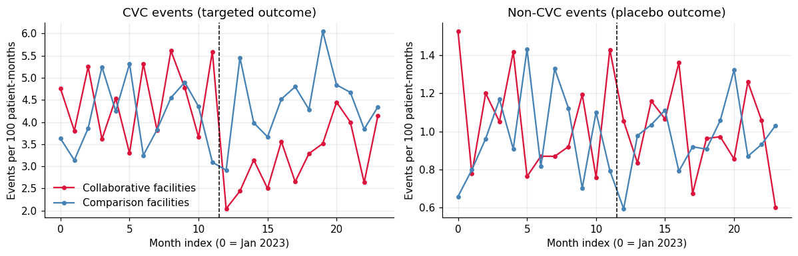
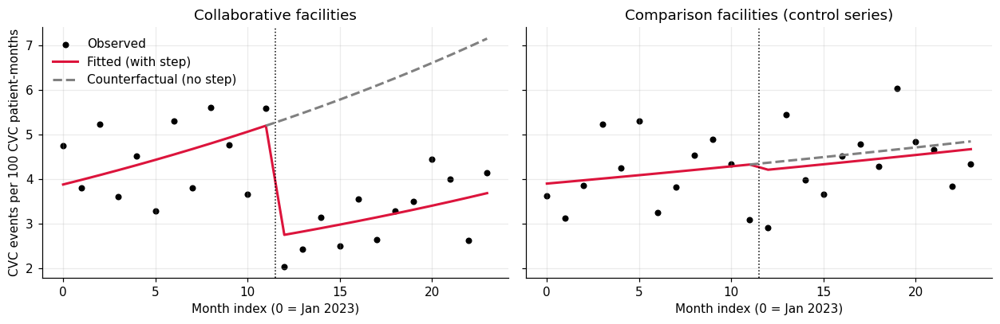
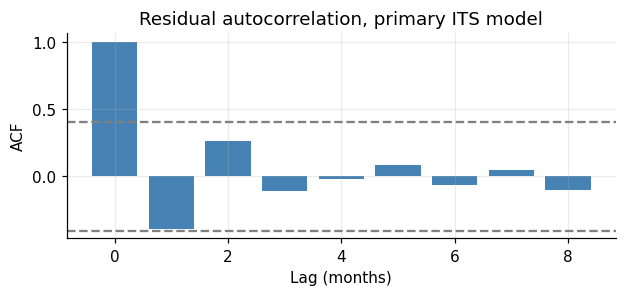
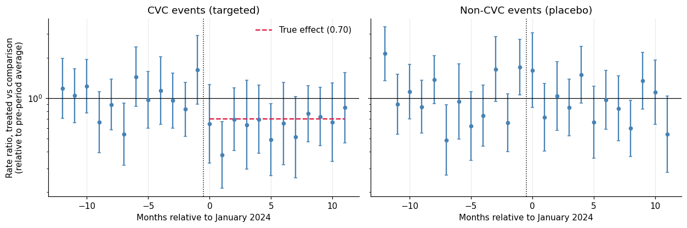
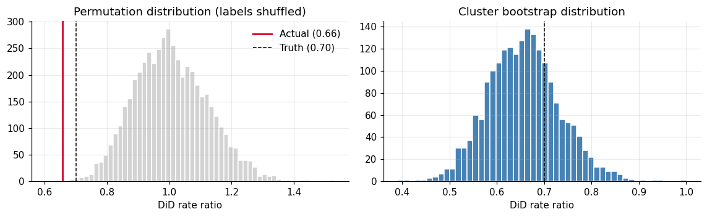
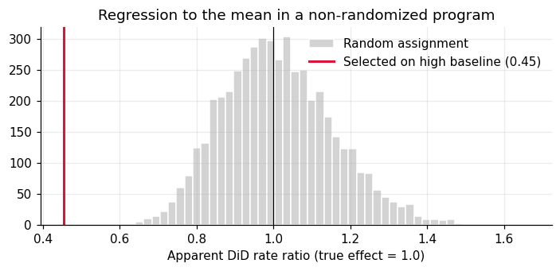
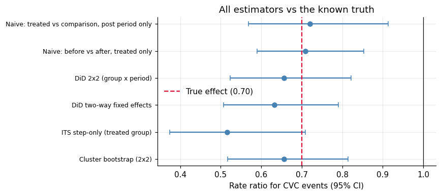

# 03. Did the Prevention Collaborative Work? Interrupted Time Series and Difference-in-Differences

[](https://colab.research.google.com/github/YOUR_GITHUB_USERNAME/nhsn-dialysis-analytics/blob/main/notebooks/03_its_did_evaluation.ipynb)


**Notebook:** [`notebooks/03_its_did_evaluation.ipynb`](../notebooks/03_its_did_evaluation.ipynb) | **Part 3 of 5** of the NHSN Dialysis Event surveillance analytics portfolio

> **Data statement.** All data are **synthetic**. No PHI and no real NHSN data are used. The prevention collaborative is fictional and its effect is built into the simulator, so every estimator can be checked against a known answer.

---

## TL;DR

A simulated CVC-reduction collaborative (61 of 160 facilities, assigned at random) starts in **January 2024** and multiplies CVC event rates by **0.70**. The notebook asks whether standard program-evaluation methods can recover that effect, and where they break.

| Question | Answer |
|---|---|
| Effect on CVC events (true 0.70)? | **DiD 0.66** (95% CI 0.52 to 0.82); two-way fixed effects 0.63 (0.51 to 0.79). Both intervals contain the truth. |
| Could it be chance? | No. Permutation test p = 0.0004; facility-level bootstrap CI 0.52 to 0.81. |
| Did non-CVC events change (placebo, true 1.00)? | No statistically detectable change (DiD 0.94, CI 0.77 to 1.15). |
| Impact? | About **138 CVC events averted in 2024** (95% interval 60 to 245; design-implied value 113). |
| Is a single-series ITS enough? | **No.** It gave 0.52 (0.37 to 0.71), barely containing the truth. Even under ideal conditions its estimate scatters from about 0.5 to 1.0. |
| Are Newey-West (HAC) standard errors safe with 24 points? | **No.** They covered the truth only **78%** of the time (target 95%) in simulation. |
| What if facilities join *because* their rates are high? | A program with **no effect** appears to cut rates by **55%** (regression to the mean). |

---

## How this notebook fits into the portfolio

| Notebook | Role of the collaborative |
|---|---|
| 01 data quality | Built the world, including the collaborative starting in January 2024. Never analyzed it. |
| 02 rate models | Used participation only as a **nuisance covariate**. Its coefficient (about 0.72 to 0.74) was a by-product, not an evaluation. |
| **03 this notebook** | Makes the collaborative **the question**: did it work, by how much, how sure are we, and what could mislead us? |

Same seed and same code as notebook 01, so facilities, events, and planted errors are identical. The main analysis uses only **validated** records; a later section shows what happens if validation is skipped.

### The known answer (for evaluation only)

| Outcome | True rate ratio |
|---|---:|
| CVC events (targeted) | **0.70** |
| Non-CVC events (AVF, AVG, other; placebo) | **1.00** |
| All events combined (diluted: CVC is 51% of expected events in treated facilities) | **0.848** |

---

## Data

| Item | Value |
|---|---|
| Treated (collaborative) / comparison facilities | 61 / 99 |
| Validated panel | 3,444 facility-months; 1,870 CVC events; 1,824 non-CVC events |
| Outcomes | CVC events per CVC patient-month; non-CVC events per non-CVC patient-month; all events per patient-month |
| Three versions of the panel | **validated** (main), **as submitted** (no validation), **clean** (simulation truth) |

Crude rates per 100 patient-months before any modeling:

| Group | Period | CVC rate | Non-CVC rate |
|---|---|---:|---:|
| Comparison | Pre (2023) | 4.11 | 0.98 |
| Comparison | Post (2024) | 4.45 | 0.96 |
| Collaborative | Pre | 4.52 | 1.07 |
| Collaborative | Post | **3.21** | 0.98 |



*Left: CVC events (targeted). The collaborative group drops after the dashed line while the comparison group does not. Right: non-CVC events (placebo) show no break.*

---

## 1. Interrupted time series (ITS)

**Idea.** Use only the collaborative facilities, summed to one monthly series, and ask whether the level or slope broke at the start date. Segmented Poisson regression with a `log(patient-months)` offset:

```
log E[events_t] = b0 + b1*time + b2*post + b3*(time since start)*post + log(patient-months_t)
```

`exp(b2)` is the **level-change rate ratio** (immediate effect); `exp(b3)` is the **slope-change ratio per month** (gradual effect).

**Pre-specified model.** The expected mechanism is an immediate step, so "step only" is the primary model and "step + slope" is a flexibility check. Choosing between them after seeing the data would inflate false positives. The choice of standard-error method is made from residual diagnostics, never from the estimated effect.

### Results

| Group | Model | Level-change RR | 95% CI |
|---|---|---:|---|
| Collaborative | **Step only, Poisson, model-based SE (primary)** | **0.516** | 0.375 to 0.709 |
| Collaborative | Step + slope (slope change 1.034 per month) | 0.504 | 0.363 to 0.700 |
| Collaborative | Step only, quasi-Poisson | 0.516 | 0.379 to 0.702 |
| Collaborative | Step only, Poisson + HAC SE (sensitivity) | 0.516 | 0.418 to 0.635 |
| Comparison (control series) | Step only, Poisson, model-based SE | 0.964 | 0.770 to 1.207 |

The control series shows no break, which supports attributing the collaborative-group drop to the program rather than to something else that changed in January 2024. The primary ITS estimate (0.52) is lower than the truth (0.70), although the truth sits just inside its interval.



*Look at the dashed counterfactual on the left: a step-only model shares one slope across all 24 months, so a noisy upward drift tilts the counterfactual upward and makes the drop look larger than a simple before/after ratio would. The trend is estimated from only 24 noisy points, which is the main reason a single-series ITS is fragile.*

### Residual diagnostics

| Check | Result | Interpretation |
|---|---|---|
| Durbin-Watson | 2.70 | No positive autocorrelation (2.0 = none) |
| Ljung-Box (6 lags) | p = 0.326 | No significant autocorrelation |
| Pearson chi-square / df | 0.94 | No overdispersion at the group level |
| Seasonality (sin/cos terms) | LR chi-square(2) p = 0.937 | No seasonal pattern |



### How trustworthy are the ITS intervals? A simulation check

500 monthly series were simulated with the same patient-months, the same baseline rate, a true level change of exactly 0.70, and **only Poisson noise** (the friendliest possible case). Share of 95% intervals that contained 0.70 (target 0.95):

| Method | Coverage |
|---|---:|
| Poisson, model-based SE | **0.948** |
| Quasi-Poisson | 0.928 |
| Poisson + HAC (Newey-West) SE | **0.784** |

HAC standard errors are the usual remedy for autocorrelation, but with only 24 time points they are too narrow. Residual diagnostics showed no autocorrelation here, so model-based errors are appropriate. The point estimate itself is noisy: across simulations its 2.5-97.5% range is **0.52 to 0.98** (truth 0.70), **even with no model misspecification**.

---

## 2. Difference-in-differences (DiD)

**Estimand.** The ratio of rate ratios, `(post/pre in treated) / (post/pre in comparison)`: the multiplicative effect of the program on the facilities that joined.

**Assumptions** (stated, then tested where possible):

1. **Parallel trends** (multiplicative): without the program, treated and comparison rates would have moved together. Testable only in the pre-period.
2. **No anticipation:** facilities did not change behavior before the start date.
3. **No spillover:** comparison facilities were not influenced by the collaborative.
4. **Stable composition:** the same facilities are observed throughout.

All estimators are Poisson with a `log(patient-months)` offset and standard errors **clustered by facility**.

| Estimator | Rate ratio | 95% CI | CI width (log) | Truth (0.70) inside? |
|---|---:|---|---:|:---:|
| Naive: treated vs comparison, post period only | 0.721 | 0.569 to 0.913 | 0.473 | yes |
| Naive: before vs after, treated only | 0.710 | 0.590 to 0.854 | 0.370 | yes |
| **DiD 2x2 (group x period)** | **0.656** | 0.524 to 0.822 | 0.450 | yes |
| **DiD two-way fixed effects (TWFE)** | **0.633** | 0.507 to 0.790 | 0.445 | yes |

**Reading the table honestly.** The naive before/after estimate looks best here (close to truth, narrowest interval). That is not evidence it is the better method: nothing else changes over time in the simulator (no secular trend, seasonality, reporting change, or regression to the mean), which is exactly the situation where before/after cannot go wrong. In real data its weakness is **bias**, not variance. DiD pays a little precision for protection against common shocks.

*TWFE caveat:* when units adopt at *different* dates, TWFE can be biased by already-treated units acting as controls (Goodman-Bacon). Here all treated facilities start together, so the problem does not arise. A staggered rollout would need Callaway-Sant'Anna or Sun-Abraham estimators.

### Other outcomes

| Outcome | Estimator | Rate ratio | 95% CI | True |
|---|---|---:|---|---:|
| Non-CVC (placebo) | DiD 2x2 | 0.939 | 0.767 to 1.149 | 1.00 |
| Non-CVC (placebo) | TWFE | 0.927 | 0.751 to 1.144 | 1.00 |
| All events | DiD 2x2 | 0.792 | 0.668 to 0.939 | 0.848 |
| All events | TWFE | 0.770 | 0.648 to 0.915 | 0.848 |

The effect on all events combined is smaller because CVC events are only about half of expected events.

### Event study: pre-trends and the shape of the effect

One coefficient per month for treated facilities. Coefficients are plotted relative to the **average of the whole pre-period**, because a single reference month is fragile with sparse counts (see the contamination note below).



*Left: CVC events. Pre-period coefficients scatter around 1; post-period coefficients drop to roughly the true 0.70 (red dashed line). Right: the non-CVC placebo stays flat.*

| Pre-trend test | CVC events | Non-CVC placebo |
|---|---|---|
| Omnibus (all 11 leads = 0), p-value | 0.126 | **0.0003** |
| Differential linear pre-trend, rate ratio per month (95% CI), p | 1.017 (0.970 to 1.066), p = 0.497 | 0.984 (0.938 to 1.032), p = 0.510 |

**Why the placebo failed the omnibus test.** That test asks whether the treated/comparison ratio is identical in all 12 pre-period months, so one unusual month is enough to trigger it. Here, December 2023 (the conventional reference month) is the unusual one: **7 of the 43 treated non-CVC events that month are silent over-reports**, which notebook 01 showed no rule can detect. The 1-degree-of-freedom linear trend test is clean for both outcomes, and the placebo DiD is near 1. A failed diagnostic should be investigated, not just reported as pass/fail. A non-significant pre-trend test also does not *prove* parallel trends (it can lack power).

---

## 3. Could this be chance or a modeling artifact?

| Check | Result |
|---|---|
| Placebo outcome (non-CVC) | DiD 0.94 (0.77 to 1.15): no detectable change |
| Placebo date (fake start July 2023, pre-period only) | RR 1.195 (95% CI 0.911 to 1.567): includes 1.0 |
| Permutation test (5,000 random relabelings of "collaborative") | Random-label RR range 0.793 to 1.252; actual 0.656; **two-sided p = 0.0004** |
| Facility-level cluster bootstrap (2,000 resamples) | RR 0.656, 95% CI **0.518 to 0.814** |



*Left: shuffling the labels almost never produces an effect as large as the real one (red). Right: the bootstrap distribution is centered near the estimate and brackets the true 0.70 (dashed).*

The permutation test needs no distributional assumptions, and the bootstrap interval does not rely on the Poisson model or asymptotic standard errors.

---

## 4. Selection bias: what if facilities join because their rates are high?

Here assignment was random, so the comparison is fair by construction. Real programs are usually voluntary or aimed at struggling facilities, which creates **regression to the mean**. To show it, the notebook uses only **2023** (no program exists yet) and invents a "program": the 40% of facilities with the highest CVC rate in the first half of 2023 are labeled "treated" and compared with the rest over the second half.

| Assignment | Apparent DiD rate ratio (true effect = 1.0) |
|---|---:|
| Selected on high baseline rates | **0.454** (a spurious **55%** reduction) |
| Random "treated" groups (5,000 draws) | mean 1.012; 95% range 0.759 to 1.319 |



**Lesson.** Random assignment, or a comparison group matched on pre-period *trend* (not just level) and tested with an event study, is what protects against this. If facilities were chosen for being bad, a plain before/after, or even DiD against unselected facilities, will overstate success.

---

## 5. Heterogeneity, data quality, and impact

### Did the program work equally everywhere?

The simulated effect is 0.70 everywhere, so any apparent differences below are noise: a reminder of how uncertain subgroup estimates are. In real data, subgroup effects should be reported as exploratory.

| Subgroup | Treated / comparison | Rate ratio | 95% CI |
|---|---|---:|---|
| Size: Small | 23 / 33 | 0.800 | 0.522 to 1.225 |
| Size: Medium | 19 / 33 | 0.451 | 0.270 to 0.755 |
| Size: Large | 19 / 33 | 0.760 | 0.584 to 0.989 |
| Ownership: Independent | 14 / 10 | 0.586 | 0.393 to 0.873 |
| Ownership: Large chain | 36 / 65 | 0.603 | 0.456 to 0.797 |
| Ownership: Nonprofit | 11 / 24 | 0.994 | 0.606 to 1.632 |
| Rural | 12 / 25 | 0.829 | 0.499 to 1.378 |
| Urban | 49 / 74 | 0.617 | 0.479 to 0.795 |

### What does skipping data validation cost?

| Data | Estimator | Rate ratio | 95% CI | CI width (log) |
|---|---|---:|---|---:|
| Clean (simulation truth) | DiD 2x2 | 0.614 | 0.504 to 0.747 | 0.393 |
| Clean | TWFE | 0.613 | 0.501 to 0.751 | 0.405 |
| Validated (notebook 01 rules) | DiD 2x2 | 0.656 | 0.524 to 0.822 | 0.450 |
| Validated | TWFE | 0.633 | 0.507 to 0.790 | 0.445 |
| As submitted (no validation) | DiD 2x2 | 0.701 | 0.545 to 0.902 | 0.503 |
| As submitted | TWFE | 0.700 | 0.547 to 0.896 | 0.493 |

**How to read it:** compare interval **width**, which grows as data quality worsens (0.39 to 0.45 to 0.50). Do **not** compare how close each point estimate lands to 0.70: with one simulated dataset that gap is mostly sampling luck, and a worse dataset can land near the truth by chance. Judging bias would require repeating the whole simulation many times. Planted errors were random with respect to treatment, so they add noise rather than systematic bias; if errors were more common in one group, bias would appear.

### Events averted

| Quantity | Value |
|---|---:|
| Observed CVC events in collaborative facilities, 2024 | 263 |
| Estimated events averted (`observed / RR - observed`) | **138** |
| 95% bootstrap interval | 60 to 245 |
| Design-implied value | 113 |

> *After the collaborative started, CVC-related events in participating facilities fell by about 34% relative to comparison facilities (rate ratio 0.66, 95% interval 0.52 to 0.81), roughly 138 fewer CVC-related events in 2024. Events that do not involve a CVC did not change, which supports attributing the drop to the CVC-focused program rather than a general reporting change. Because the reduction applies to CVC events only, the effect on all events combined is smaller.*

### All estimators against the truth



*Every interval contains the true 0.70. The single-series ITS is the furthest off and the noisiest; the naive estimates land close to the truth only because the simulator has no secular trend or shocks.*

---

## Key lessons

1. **Use a comparison group whenever you can.** A single ITS series is a noisy instrument, depends on nothing else changing at the start date, and HAC errors can be too narrow with 24 points. DiD plus an event study makes the assumptions visible and testable.
2. **Do not trust one reference month.** With sparse counts, one noisy or contaminated month can shift an entire event study. Normalize to the pre-period average and look at where data-quality problems landed.
3. **Placebo outcomes are cheap and persuasive, but read them with judgment.** A placebo diagnostic that fails can fail for mundane data reasons, which should be traced, not just reported.
4. **Report effects on the scale people use.** A rate ratio of 0.70 on CVC events becomes a smaller change in total events and a concrete number of events averted, with an honest interval.
5. **Regression to the mean is the main threat in real programs.** Design the evaluation (randomization, staggered rollout, matched comparison on pre-trends) before the program starts.
6. **Validation is part of the evaluation.** Poor data quality widens intervals, and can bias estimates if errors correlate with treatment.

## Limitations

- The effect is homogeneous, immediate, and constant in the simulator. Real effects ramp up, fade, and vary by site.
- Random assignment makes parallel trends true by construction; real programs rarely have that luxury.
- All treated facilities start together, so TWFE is valid. Staggered adoption needs modern DiD estimators.
- No spillover or anticipation is simulated. Facilities in the same network or chain may share practices.
- Standard errors assume the facility is the independent unit; real data may also cluster by network or chain.
- Only 24 months and one intervention date. Longer pre-periods make pre-trend tests more informative.
- Results are from a single simulated dataset (seed 42); the Monte Carlo ITS check shows how much one realization can mislead.

---

## Reproducibility

| Item | Detail |
|---|---|
| Seeds | `SEED = 42` for the data (recap of notebook 01) and a separate stream (`SEED + 1`) for permutations and bootstraps. Set-iteration order is sorted so data are identical across Python processes |
| Tested with | Python 3.12, statsmodels 0.15, pandas 3.0, scipy, matplotlib, run through Jupyter nbconvert |
| Not yet tested | Google Colab itself |
| Runtime | About 3 minutes (no MCMC; permutations, bootstraps, and the ITS coverage simulation dominate) |
| Install | The first code cell installs any missing package: `numpy pandas scipy matplotlib statsmodels openpyxl` |

### Outputs written by the notebook (`outputs_03/`)

| File | Contents |
|---|---|
| `its_results.csv` | ITS estimates for treated and control series, all model variants |
| `did_cvc.csv` | DiD estimators for the CVC outcome with truth indicator |
| `event_study_cvc.csv` | Event-study coefficients (relative to the pre-period average) |
| `collaborative_evaluation.xlsx` | Workbook: ITS, DiD for CVC / non-CVC / all events, event studies (both normalizations), pre-trend tests, ITS coverage simulation, heterogeneity, data-quality sensitivity, robustness checks |

## Next

**Notebook 03b** (planned): early-warning charts (CUSUM and EWMA), cluster detection, and forecasting (SARIMAX, Prophet, small LSTM) with honest benchmarking against simple baselines. Then notebook 04 (outreach prioritization with a tabular neural network and SHAP) and notebook 05 (inquiry triage, facility reports, training materials).

## References

- Bernal JL, Cummins S, Gasparrini A. Interrupted time series regression for the evaluation of public health interventions: a tutorial. *International Journal of Epidemiology* 2017;46:348-355.
- Newey WK, West KD. A simple, positive semi-definite, heteroskedasticity and autocorrelation consistent covariance matrix. *Econometrica* 1987;55:703-708.
- Goodman-Bacon A. Difference-in-differences with variation in treatment timing. *Journal of Econometrics* 2021;225:254-277.
- Callaway B, Sant'Anna PHC. Difference-in-differences with multiple time periods. *Journal of Econometrics* 2021;225:200-230.
- Sun L, Abraham S. Estimating dynamic treatment effects in event studies with heterogeneous treatment effects. *Journal of Econometrics* 2021;225:175-199.
- Roth J. Pretest with caution: event-study estimates after testing for parallel trends. *American Economic Review: Insights* 2022;4:305-322.
- Santos Silva JMC, Tenreyro S. The log of gravity. *Review of Economics and Statistics* 2006;88:641-658.
