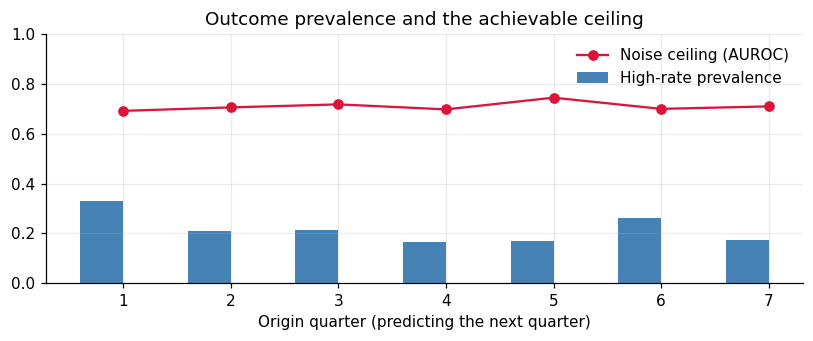
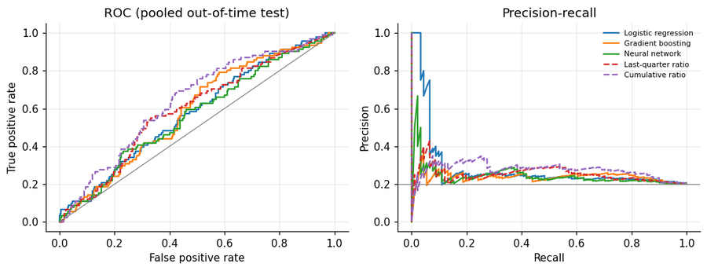
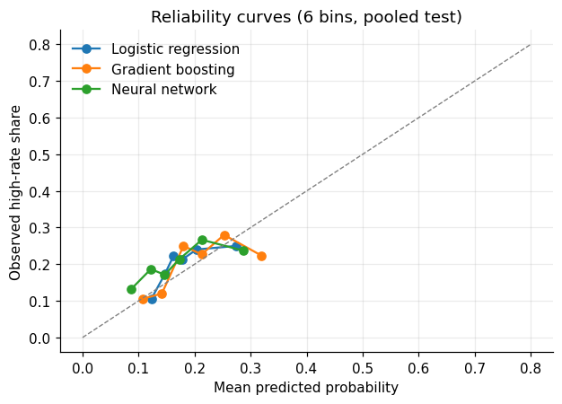
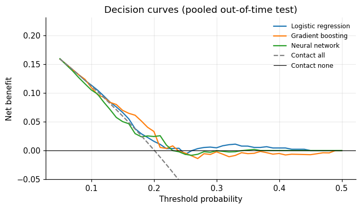
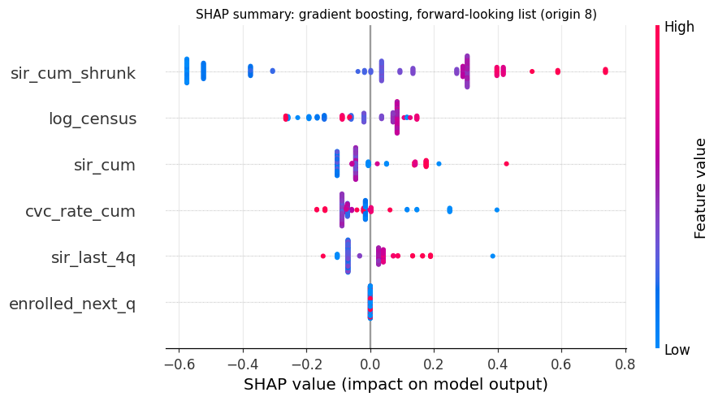
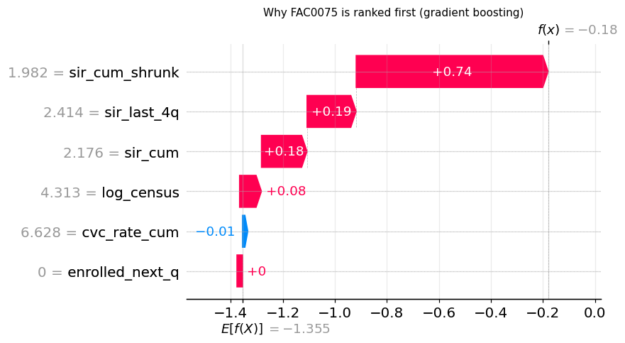
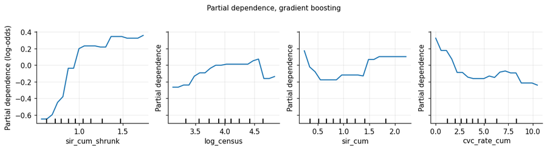
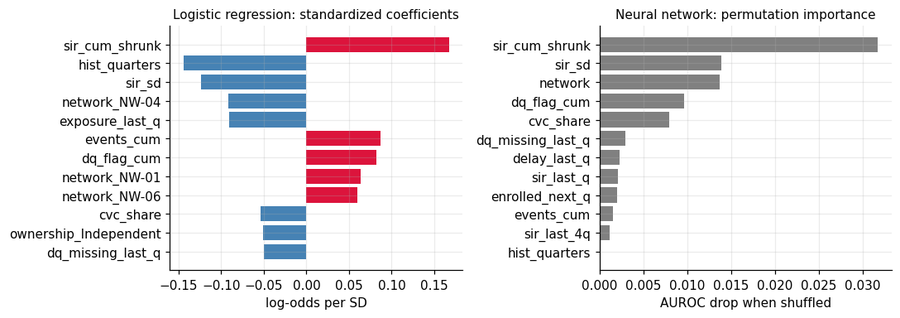
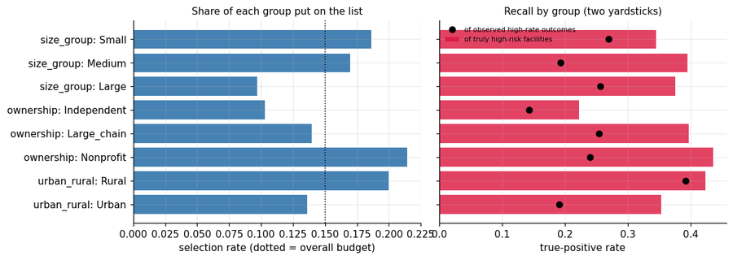

# 04. Outreach Prioritization: Which Facilities Need Attention Next Quarter?

[](https://colab.research.google.com/github/YOUR_GITHUB_USERNAME/nhsn-dialysis-analytics/blob/main/notebooks/04_outreach_prioritization.ipynb)


**Notebook:** [`notebooks/04_outreach_prioritization.ipynb`](../notebooks/04_outreach_prioritization.ipynb) | **Part 4 of 5** of the NHSN Dialysis Event surveillance analytics portfolio

> **Data statement.** All data are **synthetic**. No PHI and no real NHSN data are used. A hidden "true" facility risk exists in the simulator and is used **only for evaluation** (a performance ceiling and a fairness yardstick), never as a model input.

---

## TL;DR

Outreach staff can contact only a fraction of facilities each quarter. Given everything known at the end of a quarter, **who goes on the call list for the next one?** This notebook builds, evaluates, explains, and audits models that rank facilities by their chance of a high event rate next quarter, with a deliberately skeptical evaluation.

| Question | Answer in this notebook |
|---|---|
| Do the learned models beat a one-line baseline? | **No.** Out-of-time AUROC is 0.56 to 0.59 for logistic regression, gradient boosting, and the neural network, against **0.64** for the *cumulative ratio vs expected*. The selected logistic regression is reliably *worse* than that baseline (AUROC difference -0.060, 95% CI -0.105 to -0.016). |
| How good could any model be? | The noise ceiling (AUROC from knowing each facility's *true* risk exactly) is **0.715**. The outcome is a noisy count of about three events per quarter, so perfect knowledge of risk still cannot predict it. |
| Is a neural network better than simpler models? | No reliable difference. All pairwise model AUROC intervals include zero. On about 600 to 1,000 training rows the simplest adequate model wins by rule. |
| Are the probabilities believable? | After tuning on log loss, logistic regression is well calibrated (slope 0.94, intercept 0.03); boosting (0.62) and the network (0.46) remain overconfident. |
| Does the pipeline avoid fooling itself? | Yes. On a **negative-control target** with no signal (random data-quality errors), AUROC is 0.49 and 0.50, intervals containing 0.5. |
| Is the model fair across facility groups? | For the selected model, **0 of 9** group gaps exclude zero. But a supplementary audit shows gradient boosting under-flags independent facilities (3 of 68 selected, none of 18 truly high-risk ones), so **every candidate model must be audited**, not just the winner. |
| What should be deployed? | On this data, the credibility-weighted cumulative ratio as the operational default, with the models used for calibrated probabilities, reason codes, and auditing. The notebook produces a 24-facility call list for the unobserved next quarter either way. |

---

## How this notebook fits into the portfolio

| Notebook | Contribution here |
|---|---|
| 01 data quality | Same simulated world (same seed, identical data) and the validation rules. Only **validated** records feed the rates; validation history becomes a *feature* |
| 02 rate models | Standardized ratios (SIR) and the lesson that small facilities are noisy. A credibility-weighted (shrunken) ratio is a feature, and the "noise ceiling" idea comes from there |
| 03 collaborative evaluation | The prevention collaborative is a known program. Enrollment is a feature, and the model could in principle learn that it lowers risk (it does not, with this little data) |
| **04 this notebook** | *You are here.* |

---

## 1. The problem, defined carefully

### Timeline and leakage controls

At the end of quarter *q* ("origin *q*") everything through quarter *q* is known, and the goal is to predict quarter *q+1*:

```
quarters:   Q1    Q2    Q3    Q4    Q5    Q6    Q7    Q8   | Q9 (unobserved)
origin 1:   [known]  -> predict Q2
origin 4:   [known........] -> predict Q5
origin 7:   [known.......................] -> predict Q8
origin 8:   [known.............................] -> predict Q9   <- the real outreach list
```

Prediction models cheat in predictable ways. The controls used here:

- Every feature at origin *q* uses **only data from quarters up to *q***.
- The **expected counts** behind every standardized ratio use access-specific rates estimated **only from quarters up to *q***.
- A model predicting from origin *q* is trained only on origins whose outcome quarter is **already known** at that time.
- **No random shuffling across time.** Evaluation moves forward through the calendar.

### Outcome

A facility has a **high rate next quarter** when observed events in quarter *q+1* are at least **1.5 times expected** *and* at least **3**. The minimum avoids calling a facility "high" because of one extra event on a tiny expectation. Facilities with fewer than 1 expected event in the outcome quarter (for example, because validation removed months) are not scored.

### Features (24 numeric, 3 categorical; all known at the origin)

Recent and cumulative event counts and standardized ratios (including a credibility-weighted ratio `(O+5)/(E+5)`), trend and volatility, CVC-specific rates, access mix, census, **validation history** (flagged and missing months, delays, invalid events), enrollment in the collaborative, and facility characteristics (ownership, urban/rural, network).

### Data

| Item | Value |
|---|---|
| Facility-origin rows | 1,050 (70 dropped for under 1 expected event in the outcome quarter) |
| Training rows used | about 600 (origins before 5) to 1,050 (all labeled origins for the final model) |
| Pooled out-of-time test | **453** facility-quarters (origins 5, 6, 7) |
| Test prevalence | 20.1% |

| Origin | Rows | High next quarter | Prevalence |
|---:|---:|---:|---:|
| 1 | 151 | 50 | 0.331 |
| 2 | 149 | 31 | 0.208 |
| 3 | 146 | 31 | 0.212 |
| 4 | 151 | 25 | 0.166 |
| 5 | 153 | 26 | 0.170 |
| 6 | 149 | 39 | 0.262 |
| 7 | 151 | 26 | 0.172 |

---

## 2. Baselines and the noise ceiling

Before any model, three reference points: the **last-quarter ratio** (what a busy analyst might use), the **cumulative ratio** (all history), and the **noise ceiling** (AUROC of the *true* latent risk, available only in simulation).

| Origin | Last-quarter ratio | Cumulative ratio | Noise ceiling |
|---:|---:|---:|---:|
| 1 | 0.536 | 0.536 | 0.692 |
| 2 | 0.559 | 0.615 | 0.706 |
| 3 | 0.544 | 0.594 | 0.718 |
| 4 | 0.592 | 0.637 | 0.698 |
| 5 | 0.588 | 0.647 | 0.745 |
| 6 | 0.600 | 0.621 | 0.700 |
| 7 | 0.618 | 0.673 | 0.710 |



*The ceiling sits around 0.70 to 0.75 in every quarter. A model near the ceiling is doing all that can be done; one far below it has room to improve. The cumulative ratio matches the last-quarter ratio at origin 1 (only one quarter of history) and is higher at every later origin, consistent with averaging over more history reducing noise.*

---

## 3. The three models and the tuning protocol

- **Regularized logistic regression** (elastic-net family: ridge, or a ridge-lasso mix), on standardized features. Simple, stable, explainable.
- **Gradient boosting** (shallow trees, subsampling) on raw-unit features, so SHAP and partial dependence read in natural units.
- **Tabular neural network (PyTorch):** embeddings for categorical variables, two hidden layers (32, 16), dropout 0.3, weight decay, and an ensemble of 5 seeds.

**Protocol.** Hyperparameters, and the choice between the **full** feature set and a **compact** six-feature subset, are chosen **only on origins 1 to 4** by *forward-chaining validation* (train on origins before *k*, validate on origin *k*, for *k* = 3 and 4). Origins 5 to 7 never influence selection. The criterion is **mean log loss**, a proper scoring rule that rewards honest probabilities.

> **Transparency note.** An early version of this notebook selected on AUROC alone. That ignores calibration and produced badly overconfident boosting and neural-network probabilities (calibration slopes 0.39 and 0.28). Switching the criterion to log loss, adding the compact feature set, and tuning the network's number of epochs was done **after seeing those first test results**, so this choice was informed by the test period. The notebook states this too.

| Model | Search | Selected (by inner log loss) | Inner AUROC | Inner log loss |
|---|---|---|---:|---:|
| Logistic regression | C in {0.01 ... 1}, ridge or mix, full or compact (20 settings) | C = 0.01, ridge, **full** features | 0.576 | 0.479 |
| Gradient boosting | depth {1, 2}, trees {40, 100, 200}, full or compact (12 settings) | depth 1, 200 trees, **compact** features | 0.596 | 0.483 |
| Neural network | epochs {10, 25, 60} | **10 epochs** | 0.556 | 0.484 |

An over-trained network is overconfident: inner log loss rises from 0.484 (10 epochs) to 0.507 (25) to 0.625 (60).

---

## 4. Rolling-origin test with bootstrap confidence intervals

For each test origin (5, 6, 7) every model is **refit on all earlier origins** and predicts the next quarter, exactly as it would run in production. The three sets of predictions are pooled. Because a facility appears at several origins, intervals come from a **facility-level bootstrap** (1,000 resamples of whole facilities). Model differences are **paired** (same resamples).

| Model | AUROC (95% CI) | AUPRC (95% CI) | Brier (95% CI) |
|---|---|---|---|
| Logistic regression | 0.577 (0.516 to 0.643) | 0.289 (0.206 to 0.384) | 0.158 (0.131 to 0.185) |
| Gradient boosting | 0.586 (0.526 to 0.652) | 0.247 (0.188 to 0.331) | 0.159 (0.135 to 0.185) |
| Neural network | 0.564 (0.500 to 0.631) | 0.256 (0.191 to 0.336) | 0.161 (0.132 to 0.188) |
| Last-quarter ratio | 0.594 (0.529 to 0.659) | 0.258 (0.192 to 0.344) | n/a (not a probability) |
| **Cumulative ratio** | **0.638 (0.575 to 0.702)** | 0.284 (0.208 to 0.395) | n/a (not a probability) |

Prevalence (the AUPRC of a random scorer) is 0.201. The noise ceiling on this test set is 0.715.

### Paired differences

| Comparison | dAUROC (95% CI) | dAUPRC (95% CI) | AUROC interval excludes 0? |
|---|---|---|:---:|
| Gradient boosting minus logistic regression | +0.008 (-0.037 to +0.056) | -0.040 (-0.082 to +0.001) | no |
| Neural network minus logistic regression | -0.014 (-0.046 to +0.016) | -0.033 (-0.072 to +0.004) | no |
| Neural network minus gradient boosting | -0.022 (-0.076 to +0.031) | +0.008 (-0.031 to +0.051) | no |
| Logistic regression minus cumulative ratio | **-0.060 (-0.105 to -0.016)** | +0.001 (-0.041 to +0.040) | **yes** |
| Gradient boosting minus cumulative ratio | **-0.053 (-0.091 to -0.011)** | -0.039 (-0.087 to -0.003) | **yes** |



*The cumulative ratio (purple dashed) sits above the learned models over much of the ROC curve, though the curves are close and cross. All are modest compared with the 0.715 ceiling.*

### Pre-specified model selection and the baseline check

The selection rule was fixed before looking at fairness or explanations: **choose the simplest model whose AUROC is within one bootstrap standard deviation of the best model** (order of simplicity: logistic regression, boosting, neural network).

- Best AUROC: gradient boosting (0.586). **Selected: logistic regression (0.578).**
- Selected model minus cumulative-ratio baseline: **-0.060** (95% CI -0.105 to -0.016).

> **Recommendation produced by the notebook.** The one-line cumulative ratio ranks facilities reliably better than the selected learned model on this data. A learned model has not earned its complexity here; the cumulative (ideally credibility-weighted) ratio should be the operational default until more data show a reliable gain. The models remain useful for what they add beyond a score: calibrated probabilities, drivers, and a fairness audit.

---

## 5. Are the probabilities trustworthy, and is the list worth using?

### Calibration

A ranking can be good while its probabilities are wrong. Staff will read "30%" as 30%. The calibration **slope** (near 1 is ideal; below 1 means overconfident) and **intercept** (near 0 is ideal) come from regressing outcomes on the log-odds of the prediction.

| Model | Mean predicted | Observed rate | Intercept | Slope | Log loss |
|---|---:|---:|---:|---:|---:|
| Logistic regression | 0.181 | 0.201 | 0.032 | **0.935** | 0.495 |
| Gradient boosting | 0.202 | 0.201 | -0.512 | 0.623 | 0.497 |
| Neural network | 0.171 | 0.201 | -0.642 | 0.456 | 0.506 |



*After log-loss tuning, all three curves track the diagonal reasonably in the range where the data lie. Boosting and the network remain overconfident (slopes well below 1).*

### Decision-curve analysis

Statistical metrics do not say whether *acting* on a model helps. **Net benefit** does: at threshold probability *t* (encoding how much a wasted call costs relative to a missed facility), `net benefit = TP/n - FP/n x t/(1-t)`. A model is useful at *t* only if its curve is above both "contact everyone" and "contact no one".



At a 20% threshold (a missed high-rate facility is worth four wasted calls):

| Model | Net benefit | Contact-all | Extra true positives per 1,000 facility-quarters (net of false-alarm cost) |
|---|---:|---:|---:|
| Logistic regression | 0.016 | 0.001 | about 15 |
| Gradient boosting | 0.033 | 0.001 | about 32 |
| Neural network | 0.024 | 0.001 | about 23 |

All three beat "contact everyone" at 20%, but the advantage is small and the curves cross and wobble across thresholds, which is what noisy small-sample estimates look like. Note that gradient boosting has the best net benefit here yet the *lowest* precision in the top-K table below: metrics that answer different questions need not agree, and none of these differences is large relative to its uncertainty.

### The practical question: a fixed outreach budget

If staff can contact **15% of facilities** each quarter (68 facility-quarters pooled), how many contacted facilities are truly high-rate?

| Ranking | Precision@K | Lift vs prevalence | Recall of high-rate | Mean true risk of chosen (x average) |
|---|---:|---:|---:|---:|
| Logistic regression | 0.324 | 1.61 | 0.242 | 1.47 |
| Gradient boosting | 0.250 | 1.24 | 0.187 | 1.39 |
| Neural network | 0.294 | 1.46 | 0.220 | 1.45 |
| Last-quarter ratio | 0.235 | 1.17 | 0.176 | 1.35 |
| **Cumulative ratio** | **0.353** | **1.76** | **0.264** | **1.53** |

Prevalence is 0.201 and the average true risk of all facilities is 1.07. The last column uses the ground truth (simulation only).

---

## 6. Explainability: why was a facility flagged?

Four lenses, looking for agreement: **SHAP values** for gradient boosting, **partial dependence**, **standardized logistic-regression coefficients**, and **permutation importance** for the neural network. Explanations describe the **final models trained on all labeled origins (1 to 7)**, computed on origin 8, the *forward-looking* list for the unobserved next quarter. They describe what the model uses, **not causes**.



*Each dot is a facility; position shows the push on its score (log-odds), color shows the feature value. The credibility-weighted cumulative ratio dominates.*

| Feature (gradient boosting, compact set) | Mean abs. SHAP (log-odds) |
|---|---:|
| `sir_cum_shrunk` (credibility-weighted ratio) | 0.341 |
| `log_census` | 0.099 |
| `sir_cum` | 0.082 |
| `cvc_rate_cum` | 0.074 |
| `sir_last_4q` | 0.064 |
| `enrolled_next_q` | 0.000 |



*A per-facility explanation: starting from the average score, the credibility-weighted ratio (+0.74), the last-four-quarter ratio (+0.19), and the cumulative ratio (+0.18) push this facility to the top.*



*Predicted risk rises steeply as the credibility-weighted ratio increases from about 0.6 to 1.0 and then flattens, a plausible and interpretable shape.*



| Rank | SHAP (boosting) | Logistic regression (abs. coefficient) | Neural network (permutation) |
|---:|---|---|---|
| 1 | `sir_cum_shrunk` | `sir_cum_shrunk` | `sir_cum_shrunk` |
| 2 | `log_census` | `hist_quarters` | `sir_sd` |
| 3 | `sir_cum` | `sir_sd` | `network` |
| 4 | `cvc_rate_cum` | `network_NW-04` | `dq_flag_cum` |
| 5 | `sir_last_4q` | `exposure_last_q` | `cvc_share` |

**Reading the lenses.** All three agree on the main driver. Beyond that, agreement is only partial, which is informative:

- The **enrollment flag has no importance** (SHAP 0.000; logistic coefficient -0.017). The 30% CVC reduction in the collaborative is too small a signal for this little data, so the models ignore a program the analysts know exists.
- The logistic regression and the neural network both give weight to the **network indicators**, although networks have no true effect (notebook 02). That is noise-fitting in the weaker models, and a reason to prefer a short, domain-driven feature list when data are scarce.
- The top-24 lists from gradient boosting and logistic regression overlap on 17 of 24 facilities (Spearman correlation of probabilities 0.79).

### Plain-language reason codes

For each facility, the three features pushing its score up the most, with their values. For the five highest-ranked facilities (selected logistic regression, forward-looking list):

```
#1 FAC0013: credibility-weighted ratio vs expected = 2.25; total events to date = 64.00; CVC events to date = 30.00
#2 FAC0134: total events to date = 86.00; credibility-weighted ratio vs expected = 1.91; CVC events to date = 46.00
#3 FAC0075: credibility-weighted ratio vs expected = 1.98; total events to date = 55.00; flagged submissions to date = 3.00
#4 FAC0096: total events to date = 97.00; credibility-weighted ratio vs expected = 1.79; CVC events to date = 55.00
#5 FAC0051: credibility-weighted ratio vs expected = 2.15; flagged submissions to date = 4.00; cumulative ratio vs expected = 2.80
```

---

## 7. Fairness audit

Audit by **facility size** (terciles of census), **ownership**, and **urban/rural**, using two yardsticks that can disagree:

- **Against the observed label** (a noisy count, so smaller facilities can rarely reach "3 or more events and 1.5x expected" even when risk is high).
- **Against true latent risk** (ground truth, simulation only): of facilities that are *truly* high-risk (at least 1.3x average), what share does the model put on the call list? This separates "the model under-flags small facilities" from "the outcome is harder to observe in small facilities".

The list is the top 15% per origin. Results for the **selected model (logistic regression)**:

| Group | n | Prevalence | AUROC | Selected | TPR vs label | Precision | TPR vs true risk |
|---|---:|---:|---:|---:|---:|---:|---:|
| Size: Small | 145 | 0.179 | 0.461 | 0.186 | 0.269 | 0.259 | 0.345 |
| Size: Medium | 153 | 0.170 | 0.548 | 0.170 | 0.192 | 0.192 | 0.394 |
| Size: Large | 155 | 0.252 | 0.691 | 0.097 | 0.256 | 0.667 | 0.375 |
| Ownership: Independent | 68 | 0.103 | 0.534 | 0.103 | 0.143 | 0.143 | 0.222 |
| Ownership: Large chain | 287 | 0.206 | 0.614 | 0.139 | 0.254 | 0.375 | 0.396 |
| Ownership: Nonprofit | 98 | 0.255 | 0.483 | 0.214 | 0.240 | 0.286 | 0.435 |
| Urban/rural: Rural | 100 | 0.230 | 0.552 | 0.200 | 0.391 | 0.450 | 0.423 |
| Urban/rural: Urban | 353 | 0.193 | 0.578 | 0.136 | 0.191 | 0.271 | 0.353 |



*Left: share of each group placed on the list (dotted line = the overall 15% budget). Right: recall of truly high-risk facilities (bars) and of observed high-rate outcomes (dots).*

### Group gaps with facility-level bootstrap intervals

| Comparison | Metric | Gap | 95% CI | Excludes 0? |
|---|---|---:|---|:---:|
| Small minus Large | selected | +0.089 | -0.011 to +0.202 | no |
| Small minus Large | TPR vs label | +0.013 | -0.221 to +0.279 | no |
| Small minus Large | TPR vs true risk | -0.030 | -0.379 to +0.267 | no |
| Rural minus Urban | selected | +0.064 | -0.039 to +0.180 | no |
| Rural minus Urban | TPR vs label | +0.200 | -0.031 to +0.433 | no |
| Rural minus Urban | TPR vs true risk | +0.070 | -0.188 to +0.342 | no |
| Independent minus Large chain | selected | -0.036 | -0.123 to +0.068 | no |
| Independent minus Large chain | TPR vs label | -0.111 | -0.354 to +0.269 | no |
| Independent minus Large chain | TPR vs true risk | -0.174 | -0.456 to +0.106 | no |

**0 of 9** intervals exclude zero. With nine comparisons at 95%, about 0.5 would exclude zero by chance alone, so a single exclusion is a prompt to look closer (consistent across metrics? group large enough? plausible direction?), not proof of unfairness. Absence of an excluded interval is also weak reassurance: with 68 independent facilities and 18 truly high-risk ones, these intervals are wide.

### Supplementary check: audit every candidate model, not just the winner

The notebook audits only the model chosen by the selection rule. Reproducing the ownership audit for *all three* models from the exported `out_of_time_predictions.csv` (500 bootstrap resamples) shows that model choice matters for fairness:

| Model | Independent minus Large chain: selected | TPR vs label | TPR vs true risk | Independents selected |
|---|---|---|---|---:|
| Logistic regression | -0.036 (-0.126 to +0.065) | -0.111 (-0.345 to +0.316) | -0.174 (-0.455 to +0.109) | 7 of 68 |
| **Gradient boosting** | **-0.120 (-0.199 to -0.037)** | **-0.220 (-0.342 to -0.103)** | **-0.358 (-0.514 to -0.204)** | **3 of 68** |
| Neural network | +0.022 (-0.094 to +0.166) | -0.094 (-0.340 to +0.297) | +0.049 (-0.297 to +0.395) | 11 of 68 |

Gradient boosting put only 3 of 68 independent facilities on the list and none of the 18 truly high-risk ones, with all three intervals excluding zero. In this simulation ownership has no true effect on risk, so this is a model artifact (or chance, with a modest sample): a reminder that an audit of the winner alone can miss problems in alternatives you might switch to later. This table is **not** produced by the notebook as delivered; a short snippet to reproduce it from the CSV:

```python
t = pd.read_csv("outputs_04/out_of_time_predictions.csv")
def flag_top(df, col, frac=0.15):
    f = pd.Series(False, index=df.index)
    for _, g in df.groupby("origin"):
        f.loc[g.sort_values(col, ascending=False).index[:int(round(frac * len(g)))]] = True
    return f
for col in ["p_lr", "p_gb", "p_nn"]:
    d = t.assign(flag=flag_top(t, col))
    print(col, d.groupby("ownership").flag.mean().round(3).to_dict())
```

### Mitigation experiment: stratified selection

If small facilities are under-selected, one remedy within a fixed budget is to select the top 15% *inside each size group*. The cost and benefit are measured, not assumed:

| Selection rule | List size | Precision | TPR vs true risk (all) | Small | Medium | Large |
|---|---:|---:|---:|---:|---:|---:|
| Overall top 15% | 68 | 0.324 | 0.372 | 0.345 | 0.394 | 0.375 |
| Top 15% within each size group | 70 | 0.314 | 0.415 | 0.276 | 0.364 | 0.594 |

Stratifying **lowered** the recall of truly high-risk *small* facilities by 0.069 (and overall precision by 0.010). Equalizing how many facilities are picked per group is not the same as equalizing how well each group's risk is detected: if the underlying score is less informative for small facilities (sparse data), parity in selection counts may not close the detection gap. Better data or features for small facilities, not a quota, is the more promising route.

---

## 8. A negative control: a target with no signal to find

Data-quality problems in this simulation (late, missing, mismatched submissions) were injected **independently** in every month, so a facility's past errors say nothing about its future errors. "Poor data quality next quarter" is therefore deliberately unpredictable, and a trustworthy pipeline should return **AUROC near 0.5**.

| Model | AUROC (95% CI) | Contains 0.5? |
|---|---|:---:|
| Logistic regression | 0.487 (0.428 to 0.548) | yes |
| Gradient boosting | 0.503 (0.440 to 0.569) | yes |

The share of facility-quarters with a data-quality problem is 0.245, and the correlation between a facility's problem this quarter and next is +0.049 (essentially no persistence). If the pipeline had reported something impressive here, that would signal leakage or overfitting. Real reporting problems usually *do* persist (staff turnover, software), so on real data this target is expected to be predictable; this check tests the pipeline, not the world.

---

## 9. The outreach list for the next, unobserved quarter (Q9)

The model chosen by the selection rule (logistic regression) scores all 160 facilities at the end of Q8. The call list is the top 15%: **24 facilities** (size mix: 11 large, 8 medium, 5 small). The top 10:

| Rank | Facility | Probability high next quarter | Size | Ownership | Urban/rural |
|---:|---|---:|---|---|---|
| 1 | FAC0013 | 0.520 | Large | Large chain | Urban |
| 2 | FAC0134 | 0.490 | Large | Nonprofit | Urban |
| 3 | FAC0075 | 0.435 | Large | Large chain | Urban |
| 4 | FAC0096 | 0.432 | Large | Large chain | Urban |
| 5 | FAC0051 | 0.334 | Small | Large chain | Rural |
| 6 | FAC0143 | 0.333 | Medium | Nonprofit | Rural |
| 7 | FAC0127 | 0.313 | Medium | Large chain | Urban |
| 8 | FAC0035 | 0.310 | Medium | Large chain | Urban |
| 9 | FAC0027 | 0.299 | Small | Large chain | Urban |
| 10 | FAC0009 | 0.293 | Large | Large chain | Urban |

The top ranks are dominated by large facilities, which is plausible: more patients means more events, so more information and more extreme ratios. Given section 4's recommendation, in practice the list from the cumulative ratio would be an equally defensible, simpler alternative.

---

## Key lessons

1. **Know the ceiling before comparing models.** The outcome is a noisy count, so even perfect knowledge of risk cannot predict it. Judging models against that ceiling and against a one-line baseline is far more informative than raw AUROC.
2. **Simple is a feature.** On under a thousand training rows, neither boosting nor a neural network reliably beat a regularized logistic regression, and none beat the cumulative ratio. When differences sit within bootstrap noise, the simpler, more explainable model is the right default.
3. **Ranking quality is not decision value.** Calibration and decision curves answer different questions from AUROC: are the probabilities believable, and does acting on the list beat contacting everyone or no one at the program's own cost trade-off?
4. **Select on a proper scoring rule.** Tuning on AUROC alone gave overconfident models; tuning on log loss fixed much of it. Always disclose when a protocol choice was informed by test results.
5. **Explanations need agreement.** When SHAP, coefficients, and permutation importance point to the same driver, the explanation is credible; where they diverge (network indicators), suspect noise-fitting.
6. **Fairness has two yardsticks, and every candidate model needs an audit.** Measured against the noisy label, small facilities can look under-flagged merely because their events are rarer; measured against true risk, the picture differs. A single audited winner can hide problems in the alternatives.
7. **A negative control protects against fooling yourself.** A pipeline that cannot return AUROC near 0.5 on a target with no signal should not be trusted on one with signal.

## Limitations

- Synthetic data with a simple risk structure: persistent facility risk plus Poisson-like noise. Real risk drifts, depends on staffing, case mix, and policy, and is correlated with reporting quality.
- Data-quality errors are independent by construction (hence the negative control). Real reporting problems persist.
- About 600 to 1,050 training rows and three test origins; intervals are wide, and one simulated dataset (seed 42) is all there is. Treat model rankings as illustrative.
- The 1.5x-and-3-events outcome and the 15% budget are analyst choices. Different definitions change prevalence and which model looks best.
- The protocol was refined after seeing early test results (log-loss criterion, compact feature set, network epochs). Hyperparameter search was small, so the neural-network result is not a general verdict on deep learning for tabular data.
- Fairness is audited on three attributes only, with ground-truth risk as a yardstick no real program has. With 68 independent facilities the ownership intervals are wide.
- The supplementary all-models audit is exploratory and not part of the notebook's own pipeline.

---

## Reproducibility

| Item | Detail |
|---|---|
| Seeds | `SEED = 42` for data and models; a separate stream (`SEED + 1`) for bootstraps. Set-iteration order is sorted so the data are identical across Python processes |
| Tested with | Python 3.12, scikit-learn 1.8, SHAP 0.54, PyTorch 2.14, statsmodels 0.15, pandas 3.0, run through Jupyter nbconvert |
| Not yet tested | Google Colab itself (the first cell installs any missing package, including `shap`) |
| Runtime | About 4 to 5 minutes in the test environment on CPU |
| Layout | Tables are kept to 10 columns or fewer and figures to 900 px wide so the notebook previews stably on GitHub |

### Outputs written by the notebook (`outputs_04/`)

| File | Contents |
|---|---|
| `out_of_time_predictions.csv` | Pooled test predictions from all three models with outcomes, true-risk flag, and group attributes (used for the supplementary audit) |
| `outreach_list_next_quarter.csv` | The 24-facility call list for Q9 with probabilities and top drivers |
| `all_facilities_next_quarter_scores.csv` | Scores for all 160 facilities from all three models, ranks, and reason codes |
| `outreach_model_report.xlsx` | Workbook: prevalence, baselines and ceiling, tuning, test metrics, paired differences, negative control, top-K lists, fairness audit and gaps, SHAP importance, outreach list |

## Next

**Notebook 05** (planned): inquiry triage (classifying user questions, forecasting monthly volume), an automated facility report generator, a training deck and "how to read your rates" handout, and draft Dialysis Safety webpage text. See also [`README_03_its_did_evaluation.md`](README_03_its_did_evaluation.md) for the evaluation of the collaborative this notebook treats as a known program.

## References

- Lundberg SM, Lee SI. A unified approach to interpreting model predictions. *Advances in Neural Information Processing Systems* 2017;30:4765-4774.
- Vickers AJ, Elkin EB. Decision curve analysis: a novel method for evaluating prediction models. *Medical Decision Making* 2006;26:565-574.
- Van Calster B, McLernon DJ, van Smeden M, Wynants L, Steyerberg EW. Calibration: the Achilles heel of predictive analytics. *BMC Medicine* 2019;17:230.
- Gneiting T, Raftery AE. Strictly proper scoring rules, prediction, and estimation. *Journal of the American Statistical Association* 2007;102:359-378.
- Collins GS, Reitsma JB, Altman DG, Moons KGM. Transparent reporting of a multivariable prediction model for individual prognosis or diagnosis (TRIPOD). *Annals of Internal Medicine* 2015;162:55-63.
- Grinsztajn L, Oyallon E, Varoquaux G. Why do tree-based models still outperform deep learning on typical tabular data? *NeurIPS Datasets and Benchmarks* 2022.
- Hardt M, Price E, Srebro N. Equality of opportunity in supervised learning. *Advances in Neural Information Processing Systems* 2016;29.
- Obermeyer Z, Powers B, Vogeli C, Mullainathan S. Dissecting racial bias in an algorithm used to manage the health of populations. *Science* 2019;366:447-453.
