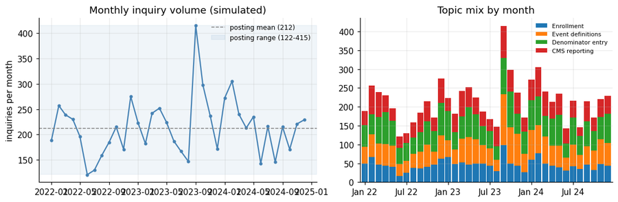
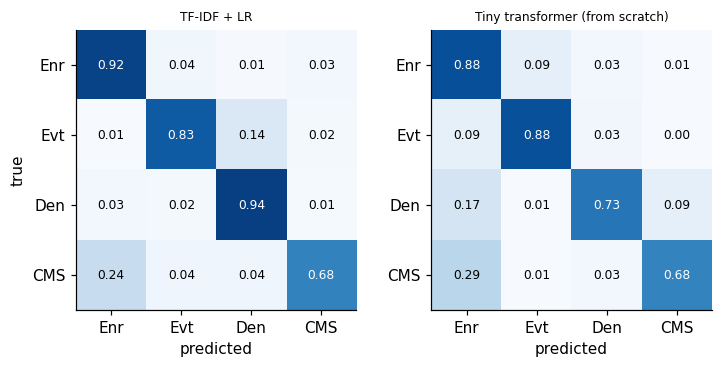
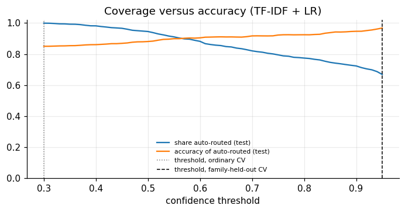
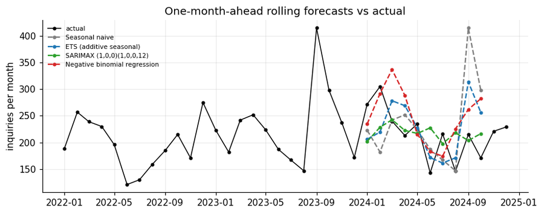
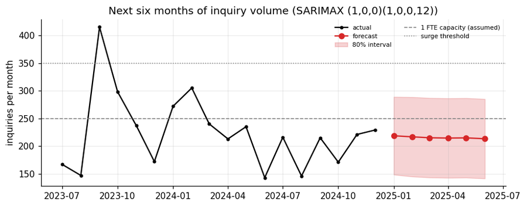
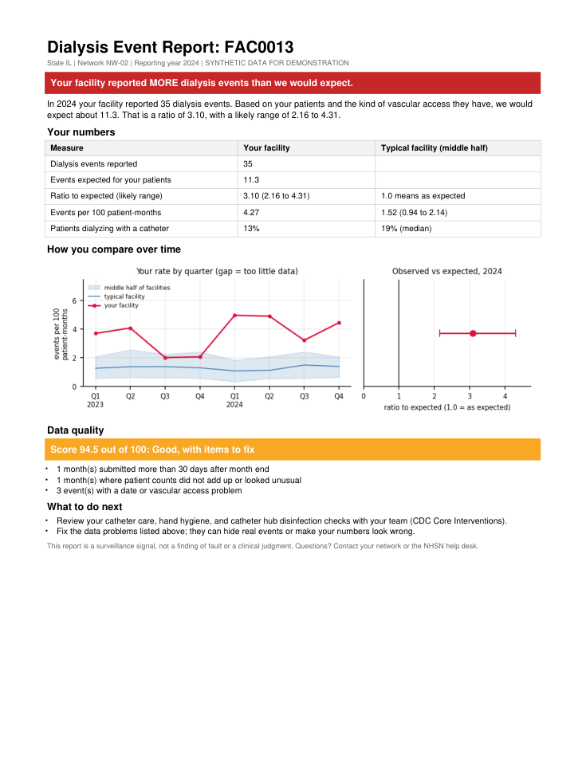
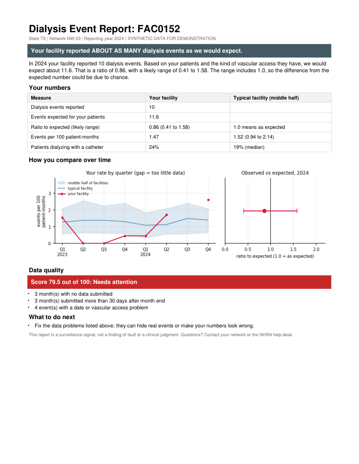
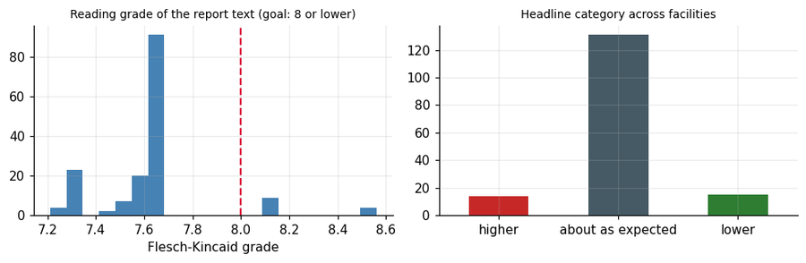
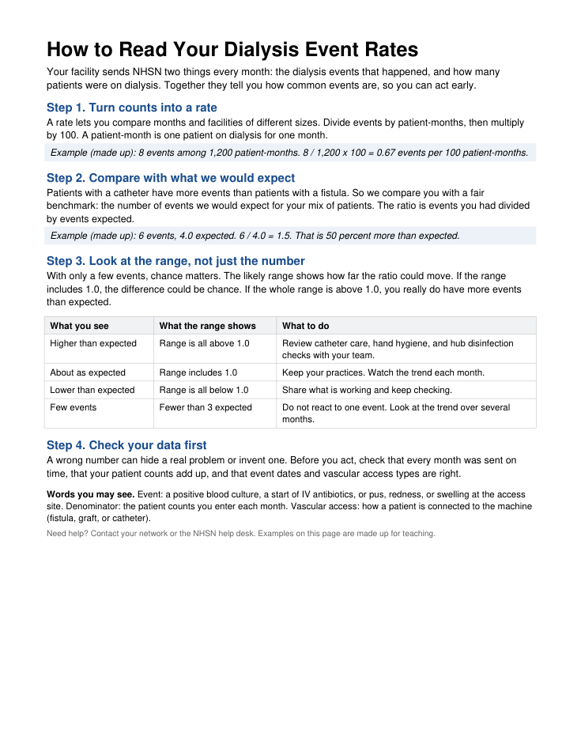

# 05. Communication, Training, and Automation

**Notebook:** [`notebooks/05_communication_training_automation.ipynb`](../notebooks/05_communication_training_automation.ipynb) | **Part 5 of 5** of the NHSN Dialysis Event surveillance analytics portfolio

> **Data statement.** All data are **synthetic**. No PHI and no real NHSN data are used. Facilities and events come from the same simulated world as notebooks 01 to 04. The inquiry messages are generated from templates (they are not real user messages), and inquiry volume is calibrated to the figures in the job posting. The web text is an **unreviewed draft**.

---

## Why this project exists

The posting asks for much more than modeling: answer a few hundred user inquiries a month, deliver 20 to 30 trainings a year, write and review outreach and web content, and produce reports users can understand. This project automates and *tests* those duties instead of just describing them.

| Duty in the posting | What was built |
|---|---|
| Handle inquiries (**about 212 per month, range 122 to 415**) | Inquiry triage (four topics), model comparison, an auto-routing rule, and a **volume forecast for staffing** |
| Create user reports | An **automated one-page facility report** (PDF and HTML) for each of 160 facilities, with a readability check |
| Prepare trainings and educational documents | A **one-page handout** ("How to read your rates") and a **7-slide training deck** |
| Write content for the CDC Dialysis Safety webpage | A **draft web page** on CVC reduction and bloodstream infection prevention, grounded in CDC's Core Interventions |

## TL;DR

| Question | Answer |
|---|---|
| Can a model route inquiries? | On **familiar phrasing**, yes: **97.2%** accuracy (TF-IDF + logistic regression). On **novel phrasing** (new wordings never seen in training) only **57.3%**. Overall 85.0%. |
| Does a small transformer help? | A transformer **trained from scratch** does **worse** on novel phrasing (**37.8%**): it only knows words it has seen. A **pretrained** embedding model is the version expected to help; it needs an internet download and **was not run in my test environment** (see below). |
| Can we trust the confidence scores? | Only if validated the right way. A threshold chosen with ordinary cross-validation routed 99.9% of messages at 85.0% accuracy (useless). Holding out whole *phrasing families* chose a strict threshold that routes **66.9% at 96.8% accuracy** and sends 33.1% to a person. |
| Can we forecast volume? | SARIMAX had the lowest rolling-origin error (MAE 34.6 vs 60.1 for seasonal naive) with 83% interval coverage (target 80%). The forecast is nearly flat (about 215 per month, 80% interval roughly 143 to 289). |
| Can reports be automated safely? | 160 reports generated, **all exactly one page**; median reading grade **7.7**, 92% at grade 8 or below. Headline categories: 131 "about as expected", 14 "higher", 15 "lower". |
| Is the handout readable? | One page, reading grade **5.7**. |
| Is the web text ready? | **No, by design.** 621 words, reading grade 6.1, seven sections; clinical specifics and links are left as marked placeholders for subject-matter reviewers. |

---

## How this project connects to the others

The facility reports reuse **the same simulated world** (same seed, identical data): the validation rules of notebook 01 (data-quality score), the standardized ratios and exact Poisson intervals of notebook 02, and the CVC focus of notebook 03. The inquiry and volume data are new and independent of the surveillance data.

---

# Part A. Inquiry triage and volume forecasting

## 1. A synthetic inquiry corpus designed to be hard in the right ways

Real inquiries cannot be shared, so messages are generated from **template families** written the way users write: different roles, greetings, typos, mixed topics, and a few vague messages. Four topics: **enrollment, event definitions, denominator entry, CMS reporting**.

| Design choice | Why |
|---|---|
| **Novel phrasing:** each topic has 7 "seen" families and 3 "novel" families with different wording; novel families **never appear in training** | Measures generalization to how people actually rephrase things, where pretrained language models are expected to help |
| **Temporal split:** train on months 1 to 24, test on months 25 to 36 | Mirrors deployment: the model predicts the future |
| **Ambiguity built in:** about 8% of messages mix two topics (labeled by the first); about 3% are vague with a random label | No model can reach 100% |

7,719 inquiries: **5,113 train** (months 1 to 24), **2,606 test** (months 25 to 36, of which **801** use novel phrasing).

Monthly volume is simulated for 36 months with a seasonal pattern, mild growth, overdispersion, and a surge when a hypothetical protocol update is released. A seed is chosen (transparently, by deterministic search) so the series matches the posting: **mean 214, min 121, max 415** (posting: about 212, range 122 to 415).

*Left: monthly volume against the posting's mean and range (the spike is the protocol-update surge). Right: topic mix by month; enrollment and CMS reporting rise in annual windows.*

## 2. Models: TF-IDF versus transformers

- **TF-IDF + logistic regression:** word and two-word features; regularization chosen by 5-fold cross-validation (C = 30).
- **Small transformer from scratch (PyTorch):** 2 encoder layers, 4 attention heads, 64-dimensional embeddings, mean pooling, ensemble of 3 seeds, vocabulary of 370 words.
- **Pretrained sentence embeddings (`all-MiniLM-L6-v2`) + logistic regression:** the "small transformer embedding model" of the original plan. It can place "Where do we begin?" near "How do I enroll?" even when those words never appeared in training.

> **Important caveat about what was run.** The pretrained model must be downloaded from the internet. My test environment was offline, so the executed notebook contains **only** the TF-IDF and from-scratch results (the notebook prints a `BACKENDS` line listing exactly what ran). On Google Colab the notebook downloads the model and adds a third row automatically, so **the pretrained result is untested here and the conclusions below about pretrained models are an expectation, not a finding.** Set the environment variable `NHSN_SKIP_PRETRAINED=1` to skip the download.

### Test results (accuracy with 95% bootstrap CI)

| Model | All test months (n = 2,606) | Familiar phrasing (n = 1,805) | Novel phrasing (n = 801) |
|---|---|---|---|
| **TF-IDF + LR** | **0.850 (0.835 to 0.864)** | 0.972 (0.965 to 0.980) | **0.573 (0.538 to 0.605)** |
| Tiny transformer (from scratch) | 0.789 (0.773 to 0.804) | 0.971 (0.963 to 0.978) | 0.378 (0.346 to 0.409) |
| MiniLM pretrained embeddings + LR | *run in Colab* | *run in Colab* | *run in Colab* |

Macro F1: TF-IDF 0.843 (0.972 familiar, 0.483 novel); tiny transformer 0.787 (0.970 familiar, 0.339 novel).

**Reading it.** Both models are essentially perfect on familiar phrasing; the whole story is novel phrasing. The from-scratch transformer cannot read a word it never saw, so it falls below even the keyword model. That is exactly the gap a pretrained model is meant to close, and exactly why the comparison must be made on the novel slice, not the overall number.

*Rows are true topics, columns predicted. The largest systematic error is CMS-reporting questions routed to enrollment (24% for TF-IDF).*

### Per-topic results (TF-IDF + LR) and where the errors are

| Topic | Precision | Recall | F1 | Support |
|---|---:|---:|---:|---:|
| Enrollment | 0.754 | 0.923 | 0.830 | 545 |
| Event definitions | 0.905 | 0.833 | 0.867 | 694 |
| Denominator entry | 0.850 | 0.940 | 0.893 | 779 |
| CMS reporting | 0.913 | 0.682 | 0.781 | 588 |

392 of 2,606 test messages (15.0%) were misrouted. Error rate by kind of message:

| Kind of message | Error rate | n |
|---|---:|---:|
| Familiar phrasing | 0.000 | 1,604 |
| Familiar + mixed topic | 0.015 | 132 |
| Novel phrasing | 0.382 | 743 |
| **Novel + mixed topic** | **1.000** | 58 |
| Vague | 0.696 | 69 |

## 3. Auto-route when confident, send the rest to a person

A confidence threshold splits the stream: confident predictions are routed automatically, the rest go to a human queue. The threshold is chosen **on the training months only** (lowest value reaching 95% accuracy among auto-routed messages) and applied unchanged to the test months. How the threshold is *validated* decides whether it is safe:

| Threshold chosen by | Cross-validated accuracy | Threshold | Auto-routed (test) | Accuracy of auto-routed | Sent to a person |
|---|---:|---:|---:|---:|---:|
| Ordinary cross-validation | 0.976 | 0.30 | 99.9% | 85.0% | 0.1% |
| **Family-held-out cross-validation** | 0.497 | 0.95 | **66.9%** | **96.8%** | 33.1% |

Ordinary cross-validation only ever tests on phrasings the model has seen, so it looks excellent at every threshold and chooses the lowest in the grid, routing nearly everything at 85% accuracy. Holding out whole template families rehearses a new wording, honestly reports about 50% accuracy, and picks the strictest threshold (0.95). At the posting's 212 messages per month that is about **142 auto-routed (about 5 misrouted) and 70 for an analyst**.

*As the threshold rises, coverage falls and accuracy of the auto-routed share rises. The two dotted/dashed lines mark the thresholds chosen by the two validation schemes.*

The rule works because the model is confidently right on phrasings it knows and uncertain on ones it does not. **Validation that rehearses the deployment shift is what made the rule safe.**

## 4. Forecasting monthly inquiry volume for staffing

Four forecasters were compared with **rolling-origin evaluation** (fit on the past, forecast three months, roll forward): 10 origins x 3 horizons = 30 forecasts per model.

| Model | MAE | MAE vs seasonal naive | 80% interval coverage | Mean interval width |
|---|---:|---:|---:|---:|
| Seasonal naive | 60.1 | 1.00 | 0.73 | 151 |
| ETS (additive seasonal) | 45.6 | 0.76 | 0.60 | 110 |
| **SARIMAX (1,0,0)(1,0,0,12)** | **34.6** | **0.58** | **0.83** | 152 |
| Negative binomial regression | 59.3 | 0.99 | 0.57 | 125 |

*Note the seasonal naive forecast (gray) for September 2024: it jumps to about 415 because it copies last year's one-off protocol-update surge as if it were seasonal.*

### From forecast to staffing

Assumptions (adjustable): one analyst-equivalent (FTE) handles about **250** inquiries a month; a month above **350** needs surge coverage. SARIMAX (lowest rolling error) produces the forecast:

| Month | Forecast | 80% interval | P(more than 250) | P(more than 350) | Suggested coverage |
|---|---:|---|---:|---:|---|
| Jan 2025 | 219 | 148 to 289 | 0.28 | 0.01 | 1 FTE |
| Feb 2025 | 217 | 145 to 288 | 0.28 | 0.01 | 1 FTE |
| Mar 2025 | 215 | 143 to 287 | 0.27 | 0.01 | 1 FTE |
| Apr 2025 | 215 | 143 to 286 | 0.26 | 0.01 | 1 FTE |
| May 2025 | 215 | 143 to 287 | 0.27 | 0.01 | 1 FTE |
| Jun 2025 | 213 | 141 to 285 | 0.26 | 0.01 | 1 FTE |

**Reading the forecast.**

1. The seasonal naive baseline copies last year's value, noise included, so it is hard to beat only if seasonality is strong. SARIMAX has the lowest error and the best interval coverage; ETS and the negative binomial regression under-cover (0.60 and 0.57).
2. The forecast is nearly flat: with only three years of data the seasonal swing is small relative to month-to-month noise. The honest message is "about 215 a month with a wide range", and the **probability of exceeding one FTE's capacity (about 27%)** matters more than the point forecast.
3. The 2024 test window contains **no surge**, so how these models and intervals behave when an unplanned spike (such as a protocol update) arrives is **not tested here**. Surge planning needs a calendar of known events and a standing escalation plan, not a better model.

---

# Part B. Automated facility reports

## 5. What goes on the page

One page per facility for the reporting year (2024), written for infection preventionists, nurse managers, and administrators.

| Block | Content | Method (from earlier notebooks) |
|---|---|---|
| Headline | One sentence: higher than, about as, or lower than expected | Observed vs expected events with an exact 95% Poisson interval (notebook 02) |
| Key numbers | Events, expected events, ratio, rate per 100 patient-months, share of patients with a catheter | Validated records only (notebook 01) |
| Trend and benchmark | Quarterly rate against the middle half of all facilities | Benchmark from the same period; **quarters with too little data are drawn as gaps, never as a false zero** |
| Data quality | Score out of 100 with the specific problems found | Simplified notebook 01 scorecard (completeness 30%, timeliness 20%, event validity 30%, denominator consistency 20%; no machine-learning component) |
| What to do next | Rule-based suggestions tied to the findings and CDC's Core Interventions | Written in advance, reviewable by staff |

*FAC0013 (highest ratio): 35 events reported against about 11.3 expected, a ratio of 3.10 (likely range 2.16 to 4.31). The page is rendered from the actual generated PDF.*

A second example shows a facility with a low data-quality score (79.5, "Needs attention"), with the specific problems listed and a gap in the trend where too little data was submitted:

### Results across all 160 facilities

| Check | Result |
|---|---|
| Reports generated | 160 PDF and 160 HTML |
| One page each | **160 of 160** (checked automatically) |
| Headline categories | 131 about as expected, 14 higher, 15 lower |
| Data-quality tiers | 95 Excellent, 59 Good with items to fix, 6 Needs attention (median score 96.7) |
| Reading level of narrative and next steps | median grade **7.7**; 92% at grade 8 or below |

Each report states that the ratio is a surveillance signal, not a finding of fault; shows the likely range; warns when few expected events make a ratio unstable; and says that the "middle half" benchmark is not a target. The Flesch-Kincaid formula is only a rough proxy: usability testing with dialysis staff is the real check.

---

# Part C. Training and web content

## 6. One-page handout: "How to read your rates"

A page providers can keep at the nursing station, using a made-up worked example in four steps: turn counts into a rate; compare with what we would expect; look at the range, not just the number; check your data first. It includes a "what you see / what the range shows / what to do" table and a plain glossary. The notebook checks that it fits on one page and measures its reading level: **1 page, grade 5.7**.

## 7. Training deck (7 slides)

A lean, text-first deck for dialysis providers, delivered separately as a slide deck (downloadable as PowerPoint or PDF). It uses made-up examples throughout and the same plain-language wording as the handout.

| Slide | Content |
|---|---|
| 1 | Cover: Understanding Your Dialysis Event Rates |
| 2 | What you report to NHSN: the three event types and the monthly denominator |
| 3 | From counts to a rate: events / patient-months x 100, with a worked example |
| 4 | Compare with what we would expect: the ratio, and how to read its range |
| 5 | Check your data first: four checks |
| 6 | The nine CDC Core Interventions to prevent bloodstream infections |
| 7 | Your next three steps and where to get help |

No speaker notes are included. To add the deck to this repository, export it as PowerPoint from the slide deck's download menu and save it as `materials/Understanding_Your_Dialysis_Event_Rates.pptx`.

## 8. Draft web text: CVC reduction and bloodstream infection prevention

[`dialysis_safety_webpage_draft.md`](../project5_materials/dialysis_safety_webpage_draft.md): 621 words, reading grade 6.1, written for dialysis staff and facility leaders. Sections: key points; why catheters matter; the nine Core Interventions; a five-step plan to reduce catheter use; using your NHSN data; resources; notes for reviewers.

It is grounded in **CDC's Core Interventions for Dialysis Bloodstream Infection Prevention** (surveillance and feedback; hand hygiene observations; vascular access care observations; staff education and competency; patient education and engagement; catheter reduction; chlorhexidine for skin antisepsis; catheter hub disinfection; antimicrobial ointment). Specific figures, product guidance, and links that I could not verify are **deliberately left as `[REVIEWER]` placeholders** rather than recalled from memory. **This is a draft for subject-matter review, not CDC-approved content**, and it contains no data from real facilities.

---

## Key lessons

1. **Test triage on how people actually write, not on how the training set was written.** The gap between familiar and novel phrasing (97% vs 57%) is the number to watch.
2. **A confidence threshold is only as good as the validation behind it.** Rehearse the deployment shift (hold out whole phrasing families); ordinary cross-validation produced a threshold that did nothing.
3. **Forecast with intervals, and test the intervals.** A staffing plan needs a range and an exceedance probability, from a model whose coverage was checked by rolling forward in time. Know what the test window does not contain (here, a surge).
4. **Automate the report, keep the human in the loop.** One generator produced 160 consistent one-page reports in seconds with logic written in advance. The same code makes page count and reading level testable, which a manual process rarely is.
5. **Say what the numbers do not mean.** Every report states that the ratio is a signal, shows the range, and warns when few events make it unstable; thinly reported quarters are shown as gaps.
6. **Draft content needs reviewers and placeholders, not confident guesses.**

## Limitations

- Inquiry texts are template-generated. Real messages are messier, longer, and often about several things. Treat all accuracy figures as illustrative.
- **The pretrained embedding model was not run in my environment.** Conclusions about it are untested until the notebook is run on Colab.
- Monthly volume is simulated to match the posting's figures. The seasonal pattern, the surge, and the 250-per-FTE capacity are assumptions. Only 36 months exist, so seasonal models see two to three cycles.
- Facility reports use a simplified data-quality score and a pooled benchmark from the same synthetic year. The wording has not been tested with real users.
- The readability formula is a rough proxy.
- The web text is an unreviewed draft grounded in CDC's published Core Interventions; it is not CDC content.

---

## Reproducibility

| Item | Detail |
|---|---|
| Seeds | `SEED = 42` for the surveillance data (identical to notebooks 01 to 04); a separate stream (`SEED + 1`) for inquiries, volume, and bootstraps |
| Determinism | An early version filled template slots by iterating a Python `set`, whose order changes between processes, so generated inquiries differed from run to run. Slot order is now sorted; the generated corpus was verified identical under three different process hash seeds |
| Tested with | Python 3.12, scikit-learn 1.8, PyTorch 2.14, statsmodels 0.15, ReportLab 4.4, PyMuPDF 1.28, pypdf 5.9, pandas 3.0, run through Jupyter nbconvert |
| Not yet tested | Google Colab itself, and the pretrained embedding model (needs a download) |
| Runtime | About 5 minutes on CPU in the test environment; most of it is the 160 reports and the forecasting rolls |
| Layout | Tables are kept to 8 columns or fewer and figures to 900 px wide so the notebook previews stably on GitHub |

### Outputs written by the notebook (`outputs_05/`)

| File | Contents |
|---|---|
| `reports_pdf/` and `reports_html/` (plus zips) | One-page report for each of 160 facilities |
| `samples/` | Four sample reports (higher, typical, lower, poor data quality) as PDF and HTML, and preview images |
| `how_to_read_your_rates_handout.pdf` | The one-page handout |
| `dialysis_safety_webpage_draft.md` | The draft web text |
| `synthetic_inquiries.csv`, `inquiry_test_predictions.csv` | The inquiry corpus and test predictions with confidences |
| `staffing_forecast.csv`, `facility_report_summary.csv` | Six-month forecast with staffing suggestion; per-facility report fields and reading grades |
| `communication_automation_report.xlsx` | Workbook of the main tables |

## Next

Planned: **notebook 03b** (early-warning charts, cluster detection, and forecasting with honest baselines), which would also let the inquiry-volume forecast above be tested against surges. See [`README_04_outreach_prioritization.md`](README_04_outreach_prioritization.md) for the outreach model that decides which facilities these reports and trainings should reach first.

## References

- CDC. Core Interventions for Dialysis Bloodstream Infection (BSI) Prevention. https://www.cdc.gov/dialysis-safety/hcp/clinical-safety
- Hyndman RJ, Athanasopoulos G. *Forecasting: Principles and Practice*, 3rd ed. OTexts, 2021.
- Kincaid JP, Fishburne RP, Rogers RL, Chissom BS. Derivation of new readability formulas for Navy enlisted personnel. 1975.
- Reimers N, Gurevych I. Sentence-BERT: sentence embeddings using Siamese BERT-networks. *EMNLP* 2019.
- Vaswani A, et al. Attention is all you need. *Advances in Neural Information Processing Systems* 2017;30.
